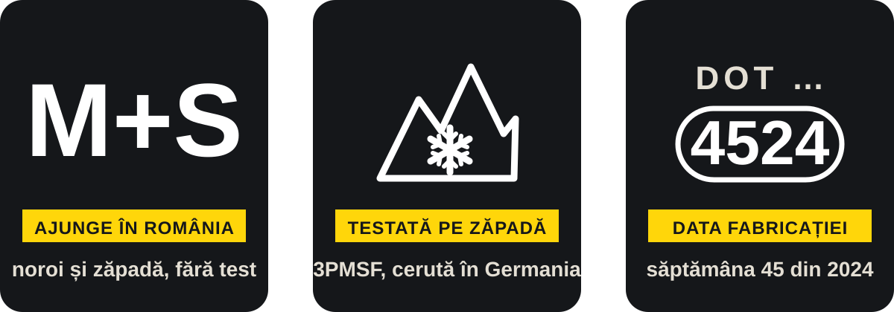

În fiecare toamnă apare aceeași întrebare: de când sunt obligatorii anvelopele de iarnă și ce amendă iei fără ele? Răspunsul scurt e că în România nu există o dată. Contează doar cum arată drumul. Am citit textul actual al Codului rutier, forma din 6 noiembrie 2026, ce spune Registrul Auto Român despre marcaje și regulile din țările prin care mergem cel mai des iarna. Mai jos găsești ce îți trebuie ca să fii în regulă aici și dacă pleci din țară.

**Pe scurt**

- **Când:** pe orice drum public acoperit cu zăpadă, gheață sau polei, indiferent de lună. Nu există o dată de la care devin obligatorii.
- **Amenda:** între 1.946,25 și 4.325 lei, din iulie 2026. Poliția îți reține și certificatul de înmatriculare, iar dovada pe care o primești nu îți dă drept de circulație.
- **Puncte de penalizare:** nu primești. „9–20 de puncte” din articolele despre amendă sunt puncte-amendă, adică mărimea amenzii, nu puncte pe permis.
- **Ce trebuie să scrie pe anvelopă:** M+S, M.S. sau M&S. Anvelopele all season sunt legale iarna dacă au acest marcaj.
- **Ce merită să cauți:** și simbolul muntelui cu fulg (3PMSF). În România nu e obligatoriu, dar în Germania anvelopele doar cu M+S nu mai contează iarna din octombrie 2024.
- **Profilul:** legea cere cel puțin 1,6 mm, dar iarna reperul e 4 mm. Atât cer manualul Škoda și legea din Austria, Serbia sau Cehia.

## Când sunt obligatorii anvelopele de iarnă în România

Codul rutier nu are o perioadă fixă. Amenda se dă pentru mașina care circulă fără anvelope de iarnă pe drumuri publice „acoperite cu zăpadă, gheață sau polei” ([OUG 195/2002, art. 102 alin. (1) pct. 28](https://legislatie.just.ro/Public/DetaliiDocument/41006)). Pe asfalt uscat, în ianuarie, nu poți fi amendat pentru anvelope de vară. Pe zăpadă, în octombrie sau în aprilie, poți.

Doar că dimineața nu știi cum arată drumul seara, mai ales dacă treci printr-un pas de munte. Așa că în practică le schimbi când se răcește, nu când a nins deja. Continental recomandă trecerea la anvelope de iarnă când temperaturile scad constant sub 7 °C, pentru că atunci compusul anvelopelor de vară și al celor all season începe să se întărească ([Continental](https://www.continental-tires.com/ro/ro/products/car/discover/by-season/winter/)).

Regula e aceeași pentru orice autoturism, inclusiv pentru unul 4x4. Tracțiunea integrală te ajută la plecare și la urcare, dar nu te oprește mai repede. Am scris despre asta în [articolul despre Superb 4x4](/recenzii/skoda-superb-4x4/#iarna-ce-face-4x4-și-ce-nu-face).

### Pe câte roți

Pentru autoturisme, codul spune doar că mașina trebuie să fie „dotată cu anvelope de iarnă”, fără să spună pe câte roți. Pune-le pe toate patru. Centrul European al Consumatorilor din Germania trece România printre țările care le cer pe toate roțile ([EVZ](https://www.evz.de/en/travelling-motor-vehicles/motor-vehicles/winter-tires-within-europe.html)), iar manualul Superb 3 cere anvelope de iarnă pe toate cele patru roți ([manualul Superb 3](https://ownersmanuals.blob.core.windows.net/ownersmanuals/ro/Superb_3V/11-2018/OwnersManual.pdf)).

### Camioane și autocare

Pentru camioanele de peste 3,5 t și autocarele cu mai mult de 9 locuri, inclusiv cel al șoferului, regula e alta. Ele au nevoie de anvelope de iarnă pe roțile punții de tracțiune sau de lanțuri ori alte echipamente antiderapante certificate pe aceste roți (același articol). Alternativa cu lanțuri e scrisă doar pentru ele: la un autoturism, lanțurile nu țin locul anvelopelor de iarnă.

## Ce amendă iei în 2026

Fapta e în clasa a IV-a de sancțiuni, care înseamnă între 9 și 20 de puncte-amendă (art. 98 alin. (4)). Un punct-amendă valorează 5% din salariul minim brut pe țară (art. 98 alin. (2)). Salariul minim a crescut pe 1 iulie 2026 la 4.325 lei, deci un punct-amendă e acum 216,25 lei. Poliția Română a confirmat cifra pentru [Digi24](https://www.digi24.ro/stiri/actualitate/social/cresc-amenzile-rutiere-de-la-1-iulie-2026-politia-romana-a-confirmat-cat-vor-plati-soferii-dupa-majorarea-salariului-minim-3838887).

Asta înseamnă o amendă între **1.946,25 lei** (9 puncte) și **4.325 lei** (20 de puncte). Cifrele de 1.305–2.900 lei sau 1.822,5–4.050 lei din articolele mai vechi sunt calculate cu punctul-amendă din anii trecuți.

Mai neplăcută decât amenda e partea a doua. Poliția îți reține certificatul de înmatriculare și îți dă o dovadă înlocuitoare **fără drept de circulație** (art. 112 alin. (1) lit. h^1 și alin. (2)). Adică nu mai pleci de acolo cu mașina până nu aduci anvelope de iarnă sau o iei cu platforma. Certificatul îl primești înapoi după ce arăți că ai rezolvat problema (art. 112 alin. (4)).

Ce nu primești sunt puncte de penalizare pe permis. Lista faptelor care aduc puncte de penalizare (art. 108) nu conține anvelopele de iarnă.

## Ce trebuie să scrie pe anvelopă

Pentru Codul rutier, anvelopele de iarnă sunt anvelope omologate după Directiva 92/23/CE sau după regulamentele CEE-ONU nr. 30 ori nr. 54 (art. 6 pct. 6^1). Pe flanc, asta se vede prin marcajul M+S. Registrul Auto Român spune că singurul criteriu legal e marcajul cu literele M și S, scris M+S, M.S. sau M&S ([RAR, citat de Digi24 în octombrie 2025](https://www.digi24.ro/stiri/economie/transporturi/cum-ar-trebui-sa-arate-anvelopele-pentru-iarna-conform-legii-registrul-auto-roman-demonteaza-miturile-si-lamureste-situatia-3442405)).

### Anvelopele all season

Denumirea „all season” nu contează pentru poliție. O anvelopă all season e legală iarna dacă are M+S pe flanc. Dacă nu are, pentru lege e o anvelopă de vară ([RAR, citat de Digi24](https://www.digi24.ro/stiri/economie/transporturi/cum-ar-trebui-sa-arate-anvelopele-pentru-iarna-conform-legii-registrul-auto-roman-demonteaza-miturile-si-lamureste-situatia-3442405)). Uită-te pe flancul anvelopei, nu în descrierea din magazin.

### M+S sau simbolul muntelui cu fulg (3PMSF)

M+S vine de la „mud and snow”, adică noroi și zăpadă. Îl pune producătorul după desenul și compoziția anvelopei, fără un test standard pe zăpadă. Simbolul cu trei vârfuri de munte și un fulg (3PMSF, numit și simbolul alpin) apare doar pe anvelopele care au trecut un test de tracțiune pe zăpadă, după regulamentul CEE-ONU nr. 117. Același simbol apare și pe eticheta europeană a anvelopei, ca „aderență pe zăpadă” ([Regulamentul (UE) 2020/740](https://eur-lex.europa.eu/eli/reg/2020/740/oj)).

În România, M+S ajunge. În Germania însă, din 1 octombrie 2024, iarna contează doar anvelopele cu simbolul alpin; cele doar cu M+S nu mai sunt acceptate pe drum de iarnă ([EVZ](https://www.evz.de/en/travelling-motor-vehicles/motor-vehicles/winter-tires-within-europe.html)). Dacă iei anvelope noi, alege-le cu ambele marcaje: știi că au trecut testul pe zăpadă și ești în regulă și dacă pleci în Germania.

### Data fabricației

Lângă literele DOT e un grup de patru cifre: săptămâna și anul fabricației. „4524” înseamnă săptămâna 45 din 2024. Uită-te la ea când cumperi, ca să știi cât au stat anvelopele în depozit, și când iei o mașină second hand cu set de iarnă inclus.

### Indicele de viteză poate fi mai mic

Anvelopele de iarnă pot avea un indice de viteză mai mic decât cel din cartea de identitate a mașinii (CIV), dar nu sub Q, adică 160 km/h. Condiția e o etichetă cu viteza maximă permisă de anvelope, lipită în mașină acolo unde o vezi mereu de pe scaunul șoferului. Anvelopele nu trebuie trecute în CIV ([RAR, după Regulamentul (UE) 458/2011](https://www.rarom.ro/?p=11011)).

## Profilul: 1,6 mm e legal, 4 mm e reperul de iarnă

Limita legală de uzură în România e 1,6 mm ([EVZ](https://www.evz.de/en/travelling-motor-vehicles/motor-vehicles/winter-tires-within-europe.html)). Cu anvelope uzate peste limită, poliția îți reține tot certificatul de înmatriculare, dar cu drept de circulație 15 zile (art. 112 alin. (1) lit. h) și alin. (2)).

Pentru iarnă, 1,6 mm e prea puțin. Manualul Škoda cere la anvelopele de iarnă cel puțin 4 mm, iar Austria, Serbia și Cehia au 4 mm ca minim legal ([ADAC](https://www.adac.de/verkehr/recht/verkehrsvorschriften-ausland/winterreifen-schneekette/)). Ia-l ca reper: dacă ai sub 4 mm, schimbă-le înainte de sezon.

## Lanțurile

La autoturisme, Codul rutier nici nu cere lanțuri, nici nu le acceptă în locul anvelopelor de iarnă. Le pui în plus, când drumul o cere, pe roțile și pe dimensiunile din manualul mașinii.

Aici manualul contează mai mult decât crezi. La Superb 3, lanțurile se pun numai pe roțile din față, chiar și la 4x4, și numai pe anvelope 215/60 R16 sau 215/55 R17. Pe jantele mele de 19" nu am voie să pun lanțuri deloc. Am scris mai pe larg despre asta în [articolul despre Superb 4x4](/recenzii/skoda-superb-4x4/#lanțurile-doar-în-față-și-doar-pe-16-sau-17).

## Dacă pleci din țară iarna

Fiecare țară are regula ei: unele după dată, altele după starea drumului, multe după amândouă. Pentru un autoturism de până la 3,5 t:

| Țara | Când | Ce îți trebuie | Profil minim | Amendă |
| --- | --- | --- | --- | --- |
| Bulgaria | 15 noiembrie – 1 martie | anvelope de iarnă sau orice anvelope cu cel puțin 4 mm profil | 4 mm | în jur de 25 € |
| Ungaria | nu există obligație | lanțuri, acolo unde indicatoarele le cer, cel puțin pe puntea motoare | – | – |
| Serbia | 1 noiembrie – 1 aprilie, pe drum de iarnă | echipare de iarnă | 4 mm | – |
| Austria | 1 noiembrie – 15 aprilie, pe zăpadă, zăpadă topită sau gheață | anvelope de iarnă (ajunge M+S) sau lanțuri pe roțile motoare când drumul e acoperit complet | 4 mm | de la circa 100 € |
| Slovenia | 15 noiembrie – 15 martie și în orice zi cu zăpadă sau gheață | anvelope de iarnă pe toate roțile sau anvelope de vară și lanțuri în mașină | 3 mm | 40 € |
| Italia | depinde de regiune și de indicatoare, de obicei 15 noiembrie – 15 aprilie | anvelope de iarnă sau lanțuri la bord, unde e semnalizat; în Valea Aosta, din 15 octombrie | – | 87–345 € |
| Germania | fără dată, pe drum de iarnă | anvelope cu simbolul alpin (3PMSF); doar M+S nu mai ajunge | 1,6 mm | 60–120 € și un punct |

Sursele sunt [ADAC](https://www.adac.de/verkehr/recht/verkehrsvorschriften-ausland/winterreifen-schneekette/) (octombrie 2026) și [EVZ](https://www.evz.de/en/travelling-motor-vehicles/motor-vehicles/winter-tires-within-europe.html) (septembrie 2026), două organizații germane care țin la zi regulile din Europa. Unde o casetă are o liniuță, sursele nu dau o cifră. Regulile se schimbă de la un an la altul și diferă pe unele drumuri, mai ales la munte, așa că verifică-le înainte de plecare. Taxele de drum, dotările obligatorii și fișele fiecărei țări sunt în [checklistul pentru drum lung](/pregatire-drum-lung/).

## Ce am eu pe Superb

Eu am iarna anvelope Hankook pe aceleași jante de 19" ca vara. Sunt foarte bune, dar ceva mai zgomotoase decât cele de vară. Pe 19" anvelopele sunt însă scumpe și se taie ușor în gropi, cum am scris în [recenzia Superb-ului](/recenzii/skoda-superb-2020-pareri-proprietar/), iar lanțuri nu pot pune deloc.

Dacă îți faci un set separat de iarnă, gândește-te la jante mai mici, dacă le acceptă frânele mașinii tale. Anvelopele sunt mai ieftine, flancul mai înalt rezistă mai bine în gropi, iar la Superb doar pe 16" și 17" ai voie să pui lanțuri. Verifică în manual ce dimensiuni sunt permise pentru motorul tău.

## Întrebări frecvente

**De când sunt obligatorii anvelopele de iarnă?** Nu de la o anumită dată. În România sunt obligatorii oricând circuli pe un drum public acoperit cu zăpadă, gheață sau polei, fie că e noiembrie, fie că e aprilie.

**Ce amendă iei fără anvelope de iarnă în 2026?** Între 1.946,25 și 4.325 lei, adică 9–20 puncte-amendă de 216,25 lei. Poliția îți reține și certificatul de înmatriculare și îți dă o dovadă fără drept de circulație, până montezi anvelope de iarnă.

**Primesc puncte de penalizare dacă nu am anvelope de iarnă?** Nu. Fapta nu e pe lista care aduce puncte de penalizare pe permis. Cifrele de 9–20 de puncte sunt puncte-amendă, din care se calculează amenda.

**Sunt legale anvelopele all season iarna?** Da, dacă au pe flanc marcajul M+S, M.S. sau M&S. Fără el, pentru lege sunt anvelope de vară, oricum s-ar numi în magazin.

**Trebuie să aibă anvelopele de iarnă simbolul cu fulg (3PMSF)?** În România nu, ajunge M+S. În Germania da: din octombrie 2024, iarna sunt acceptate acolo numai anvelopele cu simbolul alpin.

**Pot pune anvelope de iarnă doar pe două roți?** Codul nu spune pe câte roți la autoturisme, dar pune-le pe toate patru. Așa le cer producătorii, de exemplu Škoda în manualul Superb, iar țări ca Slovenia sau Cehia le cer explicit pe toate roțile.

**Am o mașină 4x4. Am nevoie de anvelope de iarnă?** Da. Legea nu face nicio excepție pentru 4x4, iar tracțiunea integrală nu te ajută la frânare. Pe zăpadă contează anvelopele.

**Pot folosi lanțuri în loc de anvelope de iarnă?** La autoturisme, nu. Legea acceptă lanțuri în locul anvelopelor de iarnă numai la camioanele de peste 3,5 t și la autocarele cu mai mult de 9 locuri.

**Câți milimetri de profil trebuie să aibă anvelopele de iarnă?** Legal, în România, cel puțin 1,6 mm, ca orice anvelopă. Iarna, reperul e 4 mm: atât cere Škoda în manual și atât cer ca minim legal Austria, Serbia și Cehia.
