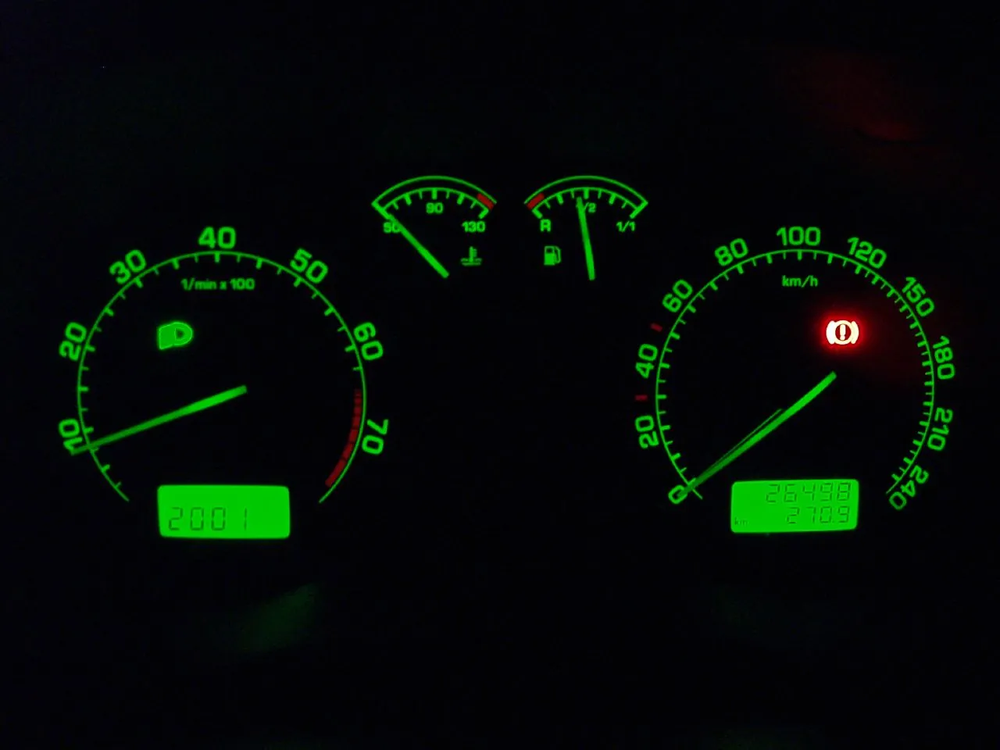

Pe bordul unei Skoda moderne pot apărea aproape 50 de martori. În manual, Škoda le spune „lămpi de control”. Am luat lista din [manualul oficial în limba română pentru Superb 3](https://ownersmanuals.blob.core.windows.net/ownersmanuals/ro/Superb_3V/11-2018/OwnersManual.pdf), generația mașinii mele, și am grupat martorii după ce trebuie să faci când se aprind: oprești, mergi la service sau doar iei la cunoștință. Lângă fiecare martor găsești simbolul lui, în culoarea din manual.

Lista nu e doar pentru Superb. Am comparat-o cu manualul Octavia 3 din aceeași perioadă și e aproape identică: Octavia are în plus doar martorii pentru versiunea pe GNC (G-TEC) și pentru modul Offroad.

**Pe scurt**

- **Roșu:** oprește în siguranță și oprește motorul; la mai mulți martori roșii, manualul spune clar să nu continui.
- **Galben:** poți merge mai departe, cu grijă, dar ajungi la service cât mai repede.
- **Verde, albastru sau alb:** îți arată doar că o funcție e pornită.
- **Clipește:** la presiunea uleiului și la blocarea volanului e mai grav decât aprins continuu; ESC-ul, în schimb, clipește când lucrează, și asta e normal.

## Ce înseamnă culorile

Culoarea îți spune cât de grav e:

- **Roșu:** pericol. Oprește cât mai repede, într-un loc sigur, departe de trafic, oprește motorul și pune avariile.
- **Galben:** avertizare. La cei mai mulți martori galbeni, manualul spune că poți continua „într-un regim de conducere foarte precaut” și că trebuie să mergi imediat la service.
- **Verde, albastru sau alb:** informare. O funcție e pornită, de exemplu faza lungă sau pilotul automat.

Pe Virtual Cockpit și pe celelalte afișaje color, simbolul e el însuși roșu sau galben. Pe afișajele monocrome, cum au multe Octavia 3, simbolul e alb, iar lângă el apare un triunghi roșu (pericol) sau galben (avertizare).

La martorii importanți apare și un mesaj pe bord, uneori cu un semnal sonor. După prima afișare, mesajul dispare și rămâne doar triunghiul roșu sau galben, până se rezolvă problema. Mesajul îl găsești din nou în Infotainment (vezi mai jos).

Simbolurile din tabele sunt cele standard, pe care le folosește și Škoda. Pe bordul mașinii tale pot arăta puțin diferit, de exemplu mai subțiri sau cu alt contur.

## Ce se aprinde când pui contactul

Când pui contactul, unii martori se aprind pentru câteva secunde. E un test: mașina verifică sistemele respective. Dacă totul e în regulă, martorii se sting la câteva secunde după ce ai pus contactul sau după ce ai pornit motorul.

În fotografia de sus, o Octavia 3 RS are contactul pus și motorul oprit. Se văd aprinși martorii EPC și de motor, ASR OFF (toți galbeni), plus centura și frâna de parcare (roșii). În dreapta e aprins verde piciorul pe pedală: mașina are cutie automată, stă în P și îți cere să apeși frâna. Cu motorul pornit, frâna de parcare eliberată și centura pusă, toți trebuie să se stingă.

Contează martorul care rămâne aprins după pornire. La diesel contează și invers: dacă spirala preîncălzirii nu se aprinde deloc la contact, e o defecțiune la preîncălzire.

## Martorii roșii: oprești

La martorii de mai jos, oprește cât de repede poți în siguranță. Excepțiile sunt frâna de parcare și centura, pe care le rezolvi pe loc.

| Martor | Ce înseamnă | Ce faci |
| --- | --- | --- |
|  Frâna | prea puțin lichid de frână | Oprește și verifică nivelul lichidului de frână. Dacă e aprins și ABS-ul, nu mai pleca. |
|  Frâna de parcare | frâna de parcare e trasă; cu mesajul „Defecțiune: frâna de parcare electrică”, frâna e defectă | Eliberează frâna. La defecțiune, mergi la service. |
|  Centura | șoferul sau pasagerul din față nu are centura pusă | Pune centura. Peste circa 30 km/h martorul clipește și mașina sună cam 2 minute. |
|  Lichidul de răcire | prea puțin lichid de răcire („Verificați nivelul lichidului de răcire”) sau motor supraîncălzit („Motor supraîncălzit Opriți!”) | Oprește, oprește motorul și lasă-l să se răcească. Verifică nivelul și pleacă doar după ce martorul s-a stins. |
|  Presiunea uleiului (clipește) | presiunea uleiului e prea mică | Oprește imediat motorul și verifică nivelul. Nu mai pleca, chiar dacă nivelul e bun, și nu lăsa motorul nici la ralanti. |
|  Alternatorul | bateria nu se încarcă în timp ce motorul merge | Mergi la service. Dacă se aprinde și martorul lichidului de răcire, oprește: există risc de avarie la motor. |
|  Servodirecția | servodirecția nu mai funcționează deloc, volanul se învârte mult mai greu | Ia contactul, pornește din nou și mergi puțin. Dacă martorul nu se stinge, oprește și cere ajutorul unui service. |
|  Blocarea volanului (KESSY), clipește | mesajul „Blocare volan defectă. Opriți!”: blocarea coloanei de direcție e defectă | Oprește. După ce iei contactul, nu mai poți porni motorul, așa că oprește unde mașina poate rămâne. |
|  Cutia automată | cutia e supraîncălzită („Cutia de viteze supraîncălzită. Opriți!”) sau defectă („Cutie de viteze defectă. Opriți autovehiculul în siguranță!”) | Oprește și oprește motorul. După o supraîncălzire, pleci când martorul s-a stins. Dacă nu se stinge, cheamă service-ul. |
|  Pilotul automat adaptiv (ACC) | ACC nu frânează destul pentru situația din față | Frânează tu. |

Despre lichidul de răcire, manualul mai spune ceva: dacă nivelul e bun și martorul se aprinde din nou, poate fi de vină ventilatorul radiatorului. Verifică siguranța ventilatorului. Dacă și ea e în regulă și martorul tot se aprinde, nu mai pleca.

## Martorii galbeni: mergi la service

Un martor galben nu te obligă să oprești pe loc. Unii sunt doar mementouri, ca rezerva de combustibil sau lichidul de parbriz.

| Martor | Ce înseamnă | Ce faci |
| --- | --- | --- |
|  Motorul („check engine”) | defecțiune la sistemul de control al gazelor arse; mașina poate intra în regim de urgență, cu puterea vizibil redusă | Mergi cu grijă la service. |
|  EPC (doar la benzină) | defecțiune la unitatea de comandă a motorului; regim de urgență, putere redusă | Mergi cu grijă la service. |
|  ABS | ABS-ul nu funcționează; frânele merg, dar fără ABS | Mergi cu grijă la service. Dacă e aprins și martorul roșu de frână, nu mai pleca. |
|  ESC/ASR | clipește: ESC sau ASR lucrează, e normal pe drum alunecos; aprins continuu: defecțiune | Dacă rămâne aprins după pornire, ia și pune din nou contactul. Dacă nu se stinge, mergi la service. |
|  ASR OFF | ai oprit controlul tracțiunii | Repornește ASR când nu mai ai nevoie. Cât timp e oprit, e oprit și Front Assist. |
|  Airbagul | sistemul de airbaguri nu funcționează („Airbagul nu este funcțional”) | Mergi imediat la service: la un accident, airbagurile pot să nu se declanșeze. |
|  Presiunea în anvelope | s-a schimbat presiunea într-o roată; dacă clipește un minut și apoi rămâne aprins, e o defecțiune la sistem | Redu viteza, oprește și verifică anvelopele. După ce corectezi presiunea, memorează valorile (vezi mai jos). |
|  Plăcuțele de frână | plăcuțele sunt uzate | Mergi la service. |
|  Rezerva de combustibil | mai ai aproximativ 6 litri în rezervor | Alimentează. |
|  Nivelul uleiului | prea puțin ulei („Completați cu ulei de motor”), prea mult („Reduceți nivelul uleiului”) sau senzorul e defect („Senzor ulei: adresați-vă unui atelier”) | Oprește și verifică nivelul. Dacă e prea puțin, completează. Dacă e prea mult sau e senzorul, mergi cu grijă la service. |
|  Servodirecția | servodirecția funcționează parțial, volanul poate fi mai greu | Ia contactul, pornește din nou și mergi puțin. Dacă nu se stinge, mergi cu grijă la service. |
|  Cutia automată | cutia e în regim de urgență (fără marșarier, viteză limitată) sau s-a încălzit („Continuare deplasare posibilă”) | Condu foarte calm și mergi la service. |
|  Blocarea volanului (KESSY), clipește | mesajul „Blocare volan: atelier!”: defecțiune sau volan rămas blocat | Mișcă puțin volanul stânga-dreapta. Dacă nu se deblochează sau mesajul rămâne, mergi la service. |
| Suspensia adaptivă (DCC): amortizor | defecțiune la DCC | Mergi cu grijă la service. |
|  Front Assist | pericol de coliziune sau frânare automată de urgență, ori sistemul nu e disponibil momentan; cu „OFF”, Front Assist e oprit | Citește mesajul de pe bord. Front Assist se oprește singur când oprești ASR sau pui ESC pe Sport. |
|  Apelul de urgență | defecțiune la sistemul de apel de urgență | Mergi la service. |
| Bec defect: bec cu raze | s-a ars un bec; mesajul de pe bord îți spune care | Înlocuiește becul sau mergi la service. |
|  Lichidul de parbriz | lichidul de spălare e pe terminate | Completează lichidul. |

Încă ceva despre martorul de presiune în anvelope: se poate aprinde și fără o problemă reală. Manualul dă exemple: mașina e încărcată mai mult pe o parte, tragi o remorcă sau urci o pantă lungă, ai pus lanțuri sau ai schimbat o roată. Invers, la condus sportiv, iarna sau pe drum neasfaltat se poate aprinde cu întârziere sau deloc. Iar la o pierdere bruscă de presiune, de exemplu la o explozie, sistemul nu te poate avertiza.

### Doar la diesel

| Martor | Ce înseamnă și ce faci |
| --- | --- |
|  Preîncălzirea | Dacă clipește, e o defecțiune la unitatea de comandă a motorului, cu putere redusă. Dacă rămâne aprins după contact sau nu se aprinde deloc, e o defecțiune la preîncălzire. În ambele cazuri, mergi cu grijă la service. |
|  Filtrul de particule | Filtrul e plin de funingine. Dacă traficul permite, mergi cu 50–120 km/h, ca filtrul să se curețe. Dacă martorul nu se stinge în 30 de minute, mergi la service. Cât e aprins, consumul e mai mare, puterea poate scădea și start-stop nu funcționează. Nu opri mașina deasupra ierbii uscate sau a frunzelor, pentru că filtrul e foarte fierbinte. |
| AdBlue | Nivelul e prea mic (completezi AdBlue) sau a apărut o eroare în sistem (mergi la service). |
|  Apă în motorină | Mesajul „Apă în filtrul de combustibil”. Mergi cu grijă la service. |

## Martorii care doar te informează

Sunt de obicei verzi, albaștri sau albi:

| Martor | Ce înseamnă |
| --- | --- |
|  Semnalizarea | Săgețile clipesc odată cu semnalizarea. Dacă una clipește de circa două ori mai repede, ceva nu merge la semnalizare, de obicei un bec ars. |
|  Faza lungă | E aprinsă faza lungă sau semnalizezi cu farurile. |
|  Asistentul pentru faza lungă | Mașina trece singură între faza scurtă și faza lungă. |
|  Proiectoarele de ceață | Sunt aprinse. |
|  Lampa de ceață spate | E aprinsă. Martorul e galben, dar doar te anunță. Stinge lampa când nu mai e ceață, pentru că îi orbește pe cei din spate. |
|  Pilotul automat și limitatorul de viteză | Când e aprins, mașina ține viteza. Când clipește, ai depășit viteza setată la limitator. |
|  Pilotul automat adaptiv (ACC) | Simbolurile arată dacă ACC e gata de pornire sau reglează viteza. Cu „!”, ACC nu e disponibil. |
|  Piciorul pe pedală | Apasă frâna. Apare la cutia automată, de exemplu când vrei să scoți maneta din P. |
|  Auto Hold | Funcția e pornită, iar mașina ține singură frâna când oprești. E același „P” ca la frâna de parcare, dar verde. |
|  Lane Assist | Arată dacă sistemul de menținere a benzii e pornit și dacă intervine. |
|  START-STOP | Arată dacă motorul a fost oprit de start-stop sau dacă sistemul nu e disponibil (A tăiat). |
|  Fulgul de nea | Afară sunt sub +4 °C. Manualul avertizează că poate fi polei și la +4 °C. |
|  ECO | Mașina merge în regim economic. La unele motoare înseamnă că o parte din cilindri s-au oprit; la cutia automată, că mașina rulează liber, cu motorul decuplat. |
|  Cheia fixă | Se apropie sau a venit termenul de revizie. |
| Soarele cu raze | Ai luminile stinse; apare și mesajul „Aprindeți lumina”. |
| Centurile din spate | Când cineva își pune sau își scoate centura în spate, simbolul arată pentru scurt timp care centuri sunt puse. |

## Combinațiile la care nu mai pleci

Manualul spune clar să nu continui în aceste situații:

- **Frâna (roșu) și ABS (galben) aprinse împreună:** sistemul de frânare are o problemă, iar distanța de frânare poate crește.
- **Bateria și lichidul de răcire aprinse împreună:** există risc de avarie la motor. Oprește motorul și cheamă asistență.
- **Presiunea uleiului clipește:** nu pleci nici dacă nivelul uleiului e bun și nu lași motorul nici la ralanti.
- **Martor de ulei și nu ai cu ce completa:** nu mai pleca, pentru că riști să strici motorul.
- **Lichidul de răcire revine după ce ai verificat tot:** nivelul e bun, siguranța ventilatorului e bună, iar martorul se aprinde din nou.
- **Cutia e supraîncălzită, iar martorul roșu nu se stinge după ce ai oprit:** cheamă service-ul.

## Mai mulți martori aprinși după ce ai schimbat bateria

Dacă bateria a fost deconectată, de exemplu la schimb, după ce pui contactul se pot aprinde martorii ESC, servodirecției și presiunii în anvelope. E normal. Trebuie să se stingă după o distanță scurtă. Dacă rămân aprinși și după o nouă pornire și o distanță scurtă, e o defecțiune și mergi la service.

**Din experiența mea:** și o baterie slabă poate scoate din funcțiune sisteme. La Superb-ul meu, când bateria a început să se descarce, pilotul automat adaptiv (ACC) n-a mai funcționat, iar senzorul radar din față s-a oprit și el. Dacă dintr-odată nu mai merg asistențele, verifică întâi bateria. Am scris despre asta și în [recenzia Superb-ului după 40.000 km](/recenzii/skoda-superb-2020-pareri-proprietar/).

## Unde vezi ce înseamnă martorul

- **Pe bord:** la prima apariție, mesajul stă pe afișaj. După aceea rămâne doar triunghiul roșu sau galben.
- **În Infotainment:** în meniul CAR, la Stare autovehicul. Acolo găsești mesajele active, iar pe desenul mașinii sunt colorate zonele cu probleme.
- **Cu un tester de diagnoză:** martorul de motor, EPC, ABS sau airbag lasă coduri de eroare memorate. Un tester OBD ieftin citește de obicei doar erorile de motor. Pentru airbag, ABS sau cutie îți trebuie un tester care știe mașinile VW, cum au service-urile.

Ștergerea erorii nu repară nimic. Dacă defectul e încă acolo, martorul revine.

## Cum stingi un martor

Cei mai mulți martori se sting singuri când dispare cauza: completezi uleiul sau lichidul de parbriz, filtrul de particule se curăță la drum, alimentezi. Doi trebuie resetați.

### Presiunea în anvelope

1. Umflă toate anvelopele la presiunea de pe eticheta mașinii, cu anvelopele reci.
2. Pune contactul și pornește Infotainment.
3. În meniul CAR, alege Stare autovehicul.
4. Alege indicatorul sistemului de control al presiunii în anvelope și apasă SET.
5. Urmează instrucțiunile de pe ecran. Un mesaj confirmă că valorile au fost memorate.

Memorează valorile de fiecare dată când schimbi presiunea, schimbi sau muți roțile ori după ce s-a aprins martorul. Škoda recomandă să le memorezi și o dată la 10.000 km sau o dată pe an. Atenție: dacă memorezi presiuni greșite, sistemul poate să nu te mai avertizeze nici la o anvelopă dezumflată.

### Service

Martorul cu cheia fixă se resetează după revizie. Manualul spune că resetarea se face într-un service autorizat și recomandă să nu o faci singur, pentru că poți seta greșit intervalul. Dacă faci revizia la un mecanic, cere-i să reseteze indicatorul cu testerul. Câți kilometri și câte zile mai ai până la revizie vezi în Infotainment, în meniul CAR, la Service.

## Pe ce modele Škoda se aplică

Lista e din manualul Superb 3 din noiembrie 2018 (anul-model 2019), cea mai nouă ediție în română pe care am găsit-o pe serverul de manuale Škoda. [Manualul Octavia 3 din aceeași lună](https://ownersmanuals.blob.core.windows.net/ownersmanuals/ro/Octavia_5E/11-2018/OwnersManual.pdf) are aceeași listă, plus martorii pentru GNC și pentru modul Offroad. La alte modele Škoda din aceeași perioadă, simbolurile principale sunt aceleași, dar verifică manualul mașinii tale.

Pentru Superb 3 facelift (2019–2023), ca al meu, n-am găsit manualul în română.

La modelele mai vechi, ca Octavia 1 sau Fabia 1, martorii sunt mai puțini și stau în cadranele analogice, dar culorile înseamnă același lucru: roșu oprești, galben mergi la service.

*Pe Octavia 1, martorul roșu de frână (cercul cu „!”) se aprinde și când e trasă frâna de mână. Foto: Shamil Khakirov, [Wikimedia Commons](https://commons.wikimedia.org/wiki/File:Skoda_Octavia_Instrument_Cluster.jpg), licență [CC BY-SA 2.0](https://creativecommons.org/licenses/by-sa/2.0/deed.ro). Fotografie redimensionată.*

Dacă te interesează Superb-ul, am scris și o [recenzie după 40.000 km](/recenzii/skoda-superb-2020-pareri-proprietar/) și un [ghid al echipărilor Style, Sportline și Laurin & Klement](/ghiduri/skoda-superb-sportline-vs-laurin-klement-vs-style/).

*Simbolurile din tabele sunt simboluri ISO 7000 și simboluri desenate de Chris828, de pe [Wikimedia Commons](https://commons.wikimedia.org/wiki/Category:Dashboard_SVG_icons), în domeniul public. Le-am pus pe fond închis și le-am colorat ca în manualul Škoda. Simbolurile EPC, ECO, fulgul de nea și cheia fixă sunt desenate pentru acest articol.*

## Întrebări frecvente

**Ce înseamnă martorul galben cu motor la Skoda?** E martorul sistemului de control al gazelor arse, cunoscut ca „check engine”. Arată o defecțiune la motor sau la sistemul de evacuare. Mașina poate intra în regim de urgență, cu puterea redusă. Poți merge, cu grijă, până la service.

**Pot să merg cu martorul de motor aprins?** Da, dacă e aprins continuu și mașina merge normal: manualul spune să continui foarte precaut și să mergi imediat la service. Dacă martorul clipește, de obicei motorul are rateuri care pot strica catalizatorul; redu viteza și mergi direct la service.

**Ce înseamnă EPC la Skoda?** EPC apare la motoarele pe benzină și înseamnă o defecțiune la unitatea de comandă a motorului. Mașina intră de obicei în regim de urgență, cu putere redusă. Mergi cu grijă la service.

**De ce clipește martorul ESC?** Pentru că ESC sau controlul tracțiunii lucrează în acel moment, de exemplu pe zăpadă sau pe drum ud. E normal. Dacă martorul rămâne aprins continuu, e o defecțiune.

**Ce înseamnă martorul roșu cu termometru?** Fie e prea puțin lichid de răcire, fie motorul s-a supraîncălzit. Oprește, oprește motorul și lasă-l să se răcească înainte să verifici nivelul.

**Ce înseamnă martorul cu roată dințată la Skoda DSG?** E martorul cutiei automate. Galben: cutia e în regim de urgență sau s-a încălzit, dar poți merge cu grijă. Roșu: oprește, pentru că cutia e supraîncălzită sau defectă.

**Cum resetez martorul de presiune în anvelope la Skoda?** Umflă toate anvelopele la presiunea recomandată, apoi în Infotainment intră în meniul CAR, la Stare autovehicul, alege sistemul de control al presiunii în anvelope și apasă SET. Un mesaj confirmă că valorile au fost memorate.

**Cum șterg martorul de service la Skoda?** Se resetează după revizie, cu un tester de diagnoză. Škoda recomandă să nu îl resetezi singur. Kilometrii rămași până la revizie îi vezi în Infotainment, în meniul CAR, la Service.

**Ce înseamnă fulgul de nea pe bord?** Că afară sunt sub +4 °C. Nu e o defecțiune, ci un avertisment că poate fi polei.

**De ce s-au aprins mai mulți martori după ce am schimbat bateria?** După deconectarea bateriei, martorii ESC, servodirecției și presiunii în anvelope se pot aprinde la pornire. Trebuie să se stingă după o distanță scurtă. Dacă rămân aprinși și după o nouă pornire, mergi la service.
