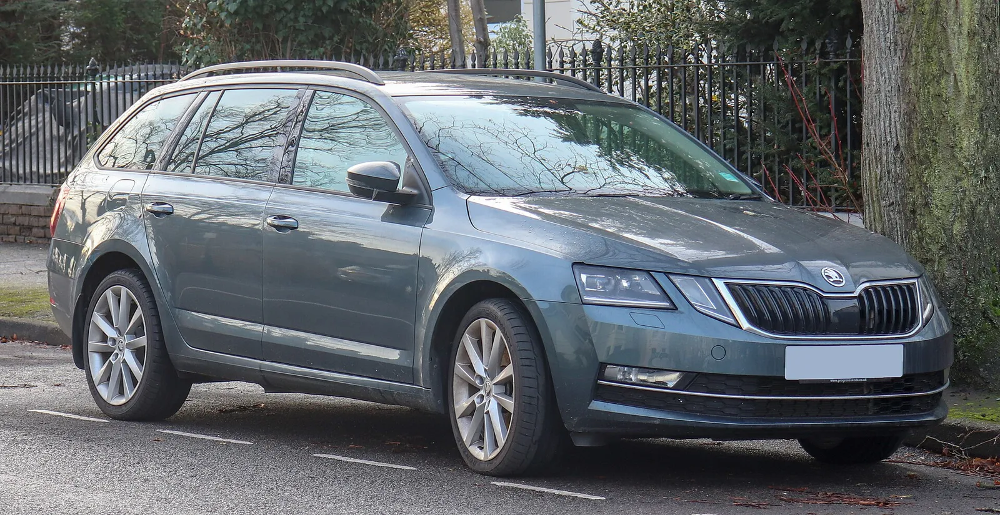
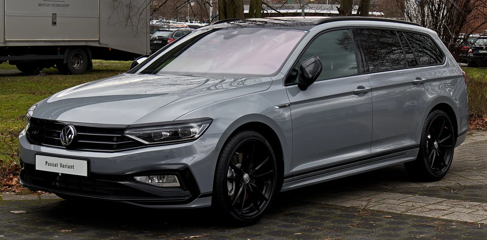
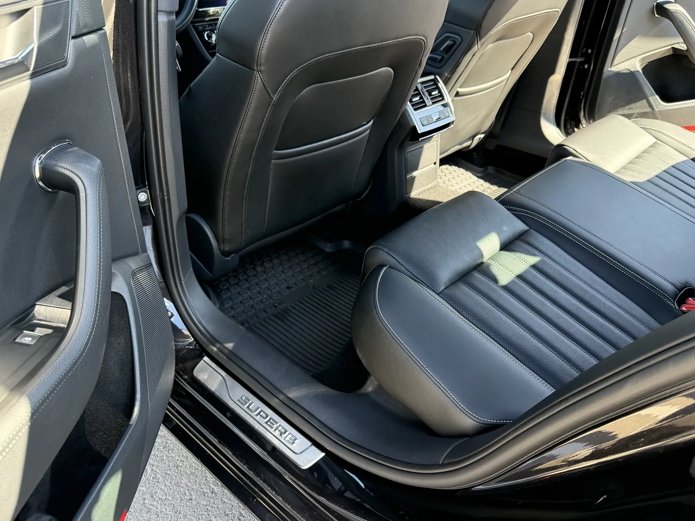
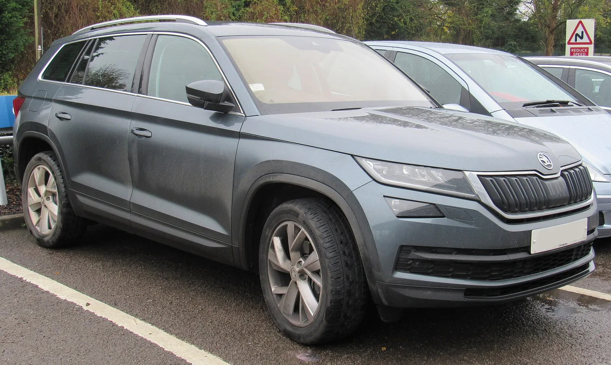
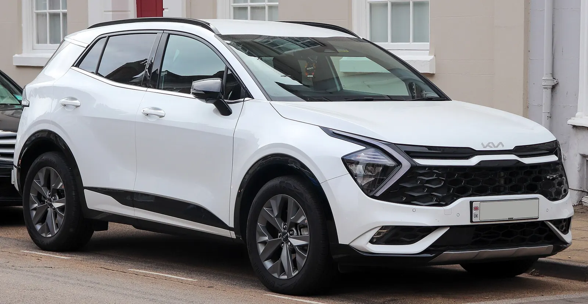
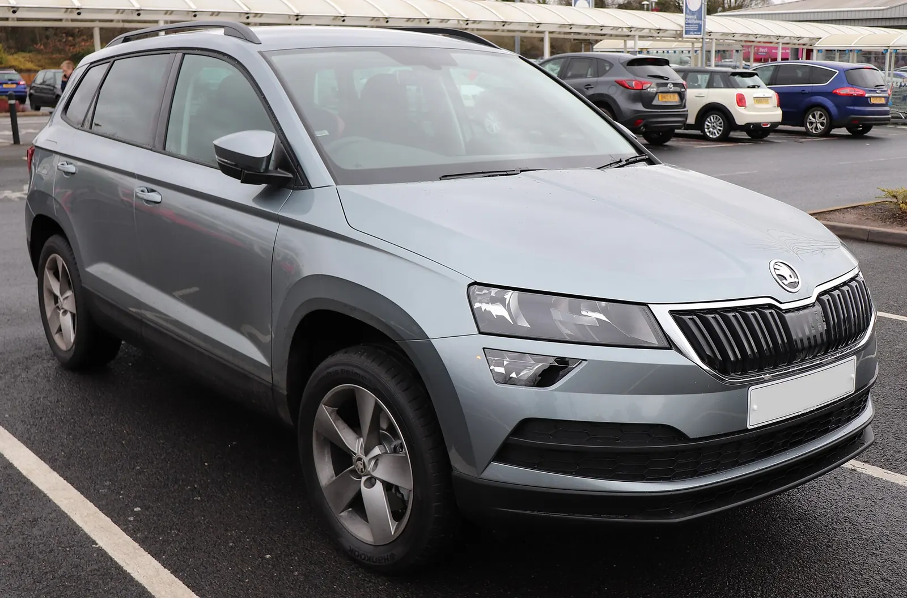
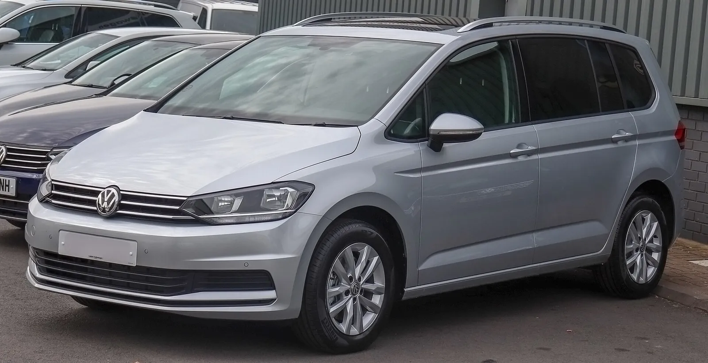
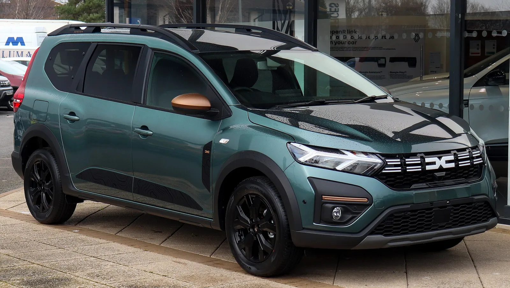

O mașină de familie trebuie să ducă oameni, bagaje și de multe ori un cărucior sau două scaune de copil. Pentru lista asta am pornit de la spațiu: litrii de portbagaj, locurile și, unde există, al treilea rând. Apoi am scos modelele pe care sursele de fiabilitate le pun la coadă: inspecțiile tehnice din Germania (TÜV), panele la care a ieșit asistența rutieră ADAC și sondajul What Car? cu proprietari din Marea Britanie.

Prețurile second hand sunt de pe Autovit, din 15 noiembrie 2026. Pentru Karoq, Sportage, Tucson, RAV4 și CR-V am păstrat prețurile din [articolul despre mașini fiabile](/topuri/masini-fiabile/), din 31 octombrie și 10 noiembrie. Cele noi sunt din listele oficiale de prețuri, cu TVA. Bugetul e de cel mult 30.000 €.

**Pe scurt**

- **Break second hand sub 10.000 €:** Skoda Octavia Combi 2017–2020, dar cu kilometraj mare.
- **Break second hand 15.000–18.000 €:** VW Passat Variant, Skoda Octavia Combi din 2021 sau Toyota Corolla Touring Sports hibrid.
- **SUV second hand:** Skoda Kodiaq, cu cel mai mare portbagaj, în jur de 19.500 €, sau Kia Sportage din 2022, în jur de 22.300 €.
- **Cu 7 locuri:** VW Touran, în jur de 11.900 €, sau Skoda Kodiaq cu 7 locuri, în jur de 19.400 €.
- **Nouă, sub 30.000 €:** Skoda Octavia Combi, Toyota Corolla Touring Sports sau Kia Sportage în promoție. Dacia Jogger dacă îți trebuie 7 locuri ieftin, cu rezerva de la Euro NCAP.
- **Cu grijă:** Skoda Superb Combi (slab la TÜV, dar mai ales la piese de uzură), Peugeot 5008 și monovolumele Sharan, Alhambra și S-Max.

## Caută după buget

Alege bugetul, caroseria și, dacă îți trebuie, 7 locuri. Pentru cele second hand, prețul e mediana de pe Autovit; o mașină apare dacă măcar anunțurile mai ieftine încap în buget.

## Cum am făcut lista

Am început cu modelele care au loc pentru o familie: breakuri, SUV-uri compacte și mari și monovolume, cu 5 locuri și un portbagaj de cel puțin 520 l. Portbagajul e cifra producătorului, măsurată după metoda VDA, cu 5 locuri și spătarele ridicate.

Apoi am verificat fiabilitatea, cu aceleași surse ca în [articolul despre mașini fiabile](/topuri/masini-fiabile/):

| Sursă | Ce măsoară | Ediția folosită |
| --- | --- | --- |
| [TÜV-Report 2026](https://www.tuvsud.com/de-de/publikationen/tuev-report/maengelzwerge-und-fehlerriesen) | câte mașini pică inspecția tehnică periodică din Germania (echivalentul ITP) cu defecte grave, pe vârste de la 2 la 13 ani | noiembrie 2025; cifrele pe model, din tabelele publicate de AUTO BILD |
| [ADAC Pannen&shy;statistik 2026](https://www.adac.de/rund-ums-fahrzeug/unfall-schaden-panne/adac-pannenstatistik-2026/) | la câte pane a ieșit ADAC, pentru mașini de 2–9 ani | aprilie 2026, pane din 2025 |
| [What Car? Reliability Survey](https://www.whatcar.com/news/reliability-survey-most-reliable-cars-brands/n26159) | defectele raportate de proprietari la mașini de până la 5 ani | 2026 unde există, altfel 2025; anul e scris lângă fiecare notă |
| [Driver Power](https://www.autoexpress.co.uk/best-cars-vans/91220/most-and-least-reliable-car-manufacturers-2026) | nota de fiabilitate dată de proprietari, pe mărci | august 2026 |
| Euro NCAP | testele de impact, inclusiv protecția copiilor | cel mai recent rating al modelului |

Regula e mai blândă decât acolo. În articolul despre mașini fiabile, un model trebuia să fie printre cele mai bune în cel puțin două surse. Aici ajunge să nu fie la coada niciuneia. Le-am pus „cu rezerve” când o sursă le trage în jos, când singura notă pe model e de la What Car?, un sondaj doar cu mașini de până la 5 ani, sau când au ieșit slab la Euro NCAP. Octavia din 2017–2020 are date pe model doar de la TÜV, dar a rămas în listă: TÜV arată defectele chiar la vârsta la care o cumperi acum, 6–9 ani.

De aceea Skoda Octavia din 2020 e aici în listă, deși în articolul despre mașini fiabile apare printre modelele care nu ies bine. Nu e printre cele mai fiabile, dar nici la coada vreunei surse, iar la spațiu pe bani e greu de bătut.

Ratingurile Euro NCAP expiră după 6 ani. Nu înseamnă că mașina a devenit mai puțin sigură, ci că testele s-au înăsprit între timp.

## Ce spune fiecare sursă

Tabelul pune una lângă alta cele patru surse de fiabilitate, pentru modelele din listă, pentru cele cu rezerve și pentru câteva mașini de familie populare care nu ies bine. Numele modelului te duce la secțiunea despre el.

## Break-uri second hand

Pe bani egali, un break are de obicei mai mult portbagaj decât un SUV. Toate cele de mai jos au aproape 600 l sau mai mult. Prețurile mici vin însă des cu kilometraje mari: la Octavia și Passat, jumătate din anunțuri au peste 160.000 km.

### Skoda Octavia Combi (2017–2020, a treia generație)

La TÜV, Octavia 3 e puțin sub media defectelor la vârstele de acum: 12,4% la 6–7 ani, față de o medie de 13,6%, și 16,5% la 8–9 ani, față de 18,3%. Nu e în top 10, dar nici la coadă. Portbagajul are 610 l.

Pe Autovit sunt 112 anunțuri din 2017–2019, cu un median de 9.390 € și 222.000 km. E singurul break din listă sub 10.000 €.

**Atenție la:** kilometraj și cutie. Jumătate din mașini au peste 222.000 km. AUTO BILD trece printre punctele slabe ale generației cutia DSG și consumul de ulei la motoarele 1.8 și 2.0 TSI. La benzină cu automată, află ce DSG are mașina (DQ200 cu ambreiaj uscat sau una cu ambreiaje în baie de ulei) și ce s-a făcut la ea în service.

*Foto: Vauxford, [Wikimedia Commons](https://commons.wikimedia.org/wiki/File:2017_Skoda_Octavia_SE_L_TDi_S-A_Estate_2.0_Front.jpg), licență [CC BY-SA 4.0](https://creativecommons.org/licenses/by-sa/4.0/deed.ro). Fotografie redimensionată.*

### Skoda Octavia Combi (din 2020, a patra generație)

Generația nouă are portbagajul ceva mai mare, 640 l, și 5 stele la [Euro NCAP](https://www.euroncap.com/assessments/skoda/octavia/0785/), obținute în 2019 chiar pe un Octavia Combi: 92% la protecția adulților și 88% la a copiilor. Ratingul a expirat la 1 ianuarie 2026, ca toate cele din 2019.

La fiabilitate e la mijloc. La TÜV are 6,9% defecte la 2–3 ani, puțin peste media de 6,5%, iar la What Car? 2025 are 89,5%.

Pe Autovit sunt 149 de anunțuri din 2021–2023, cu un median de 15.780 € și 162.000 km. Nouă, Octavia Combi pornește de la 27.933 €.

**Atenție la:** kilometraj și ecran. Multe anunțuri sunt diesel cu 160.000–300.000 km, kilometraje tipice pentru mașini de flotă. La What Car? 2025, sistemul multimedia e pe lista defectelor raportate de proprietari.

### Volkswagen Passat Variant (B8, 2015–2023)

La ADAC, Passat-ul e printre cele mai fiabile mașini din clasa mijlocie. La TÜV e aproape de medie la vârstele care încap în buget: 11,9% la 4–5 ani, față de 10,0%, și 13,2% la 6–7 ani, față de 13,6%. După 10 ani cifrele se strică: 28,6% la 10–11 ani, față de o medie de 22,9%. Portbagajul are 650 l.

Pe Autovit sunt 105 anunțuri din 2019–2022, cu un median de 15.500 € și 182.000 km.

**Atenție la:** pierderi de ulei, discuri de frână și arcuri, pe care AUTO BILD le trece printre punctele slabe la TÜV. La 4Motion, cere dovada schimbului de ulei la Haldex și la DSG.

*Foto: M 93, [Wikimedia Commons](https://commons.wikimedia.org/wiki/File:VW_Passat_Variant_2.0_TDI_4Motion_R-Line_Edition_%28B8%2C_Facelift%29_%E2%80%93_f_16022020.jpg), licență [CC BY-SA 3.0 DE](https://creativecommons.org/licenses/by-sa/3.0/de/deed.ro). Fotografie redimensionată.*

### Toyota Corolla Touring Sports hibrid (din 2019)

Corolla are 96,5% la What Car? 2025, notă dată pentru toate caroseriile. ADAC trece însă Corolla din 2023 pe lista problemelor, din cauza bateriei de 12 V; detaliile sunt în [articolul despre mașini fiabile](/topuri/masini-fiabile/#toyota-fiabilă-dar-verifică-bateria-de-12-v). Portbagajul e cel mai mic dintre breakurile din listă: 598 l la motorul 1.8 și 581 l la 2.0.

Pe Autovit sunt 79 de anunțuri hibride din 2019–2022, cu un median de 16.974 € și 128.000 km, cele mai mici kilometraje dintre breakuri. Nouă, pornește de la 26.869 € după promoție.

**Atenție la:** bateria de 12 V. Cere un test și întreabă dacă a fost schimbată.

**Dacă găsești una:** Kia Ceed SW din 2018 are 98,8% la What Car? 2025, notă dată pentru toate caroseriile Ceed, și un portbagaj de 625 l. Pe Autovit am găsit însă doar 15 anunțuri din 2018–2022, cu un median de 11.988 €.

### Skoda Superb Combi (2015–2023, a treia generație)

Superb Combi are cel mai mare portbagaj dintre breakuri, 660 l, iar ampatamentul de 2.841 mm se simte pe bancheta din spate.

La TÜV iese însă slab. La 2–3 ani e pe locul 101 din 110, cu 9,6% defecte, iar la 4–5 ani are 12,1%, față de o medie de 10,0%. AUTO BILD scrie că problemele sunt mai ales la arcuri, amortizoare și frâne, plus pierderi de ulei. Sunt lucruri pe care un mecanic le vede la o verificare înainte de cumpărare, nu defecte de motor sau de cutie. La What Car? 2025, Superb pe benzină are 93,8%. La diesel, proprietarii au raportat mai multe defecte, iar reparațiile au fost mai scumpe.

Pe Autovit sunt 60 de anunțuri Combi din 2019–2022, cu un median de 17.490 € și 161.000 km.

Eu am un Superb 2020, dar liftback, nu Combi. L-am cumpărat cu 80.000 km și în aproape 40.000 km nu s-a stricat nimic important. Portbagajul l-am testat la două mutări: cu bancheta rabatată a încăput o placă de gresie de 120 × 60 cm și a mai rămas loc de bagaje. Detaliile sunt în [recenzia mea](/recenzii/skoda-superb-2020-pareri-proprietar/), iar despre echipări am scris în [comparația Sportline, L&K și Style](/ghiduri/skoda-superb-sportline-vs-laurin-klement-vs-style/).

**Atenție la:** suspensie și frâne, de acolo vine scorul de la TÜV. La 4x4, cere dovada schimbului de ulei la Haldex; despre tracțiunea integrală am scris [separat](/recenzii/skoda-superb-4x4/).

*Superb-ul meu, care e liftback, nu Combi.*

## SUV-uri de familie second hand

Un SUV te ține mai sus și e mai ușor de urcat în el cu un copil în brațe. Pe bani egali, are însă de obicei portbagaj mai mic decât un break. Excepția e Kodiaq-ul.

### Skoda Kodiaq (2016–2024, prima generație)

Kodiaq are 720 l de portbagaj cu 5 locuri, mai mult decât orice break din listă, și se vinde și cu 7 locuri. La TÜV e pe locul 8 la 6–7 ani, cu 8,7% defecte, față de o medie de 13,6%. La What Car? 2025, versiunea diesel are 97,8%, a doua cea mai bună notă dintre mașinile cu 7 locuri, iar cea pe benzină 92,2%. A primit 5 stele la [Euro NCAP](https://www.euroncap.com/assessments/skoda/kodiaq/0669/) în 2017; ratingul a expirat, iar generația din 2024 a luat tot 5 stele.

Pe Autovit sunt 135 de anunțuri din 2018–2021, cu un median de 19.550 € și 171.000 km. Nou, Kodiaq pornește de la 40.067 €, peste bugetul articolului.

**Atenție la:** consumul de ulei la 2.0 TSI, injectoarele și turbo la diesel și brațele suspensiei, după AUTO BILD. Tot acolo scrie că, la prima inspecție, Kodiaq-ul are pierderi de ulei de două ori mai des decât media.

*Foto: Vauxford, [Wikimedia Commons](https://commons.wikimedia.org/wiki/File:2017_Skoda_Kodiaq_TDi_SCR_4x4_2.0.jpg), licență [CC BY-SA 4.0](https://creativecommons.org/licenses/by-sa/4.0/deed.ro). Fotografie redimensionată.*

### Kia Sportage (din 2022, a cincea generație)

Sportage-ul nou e pe locul 8 la TÜV la 2–3 ani (4,0% defecte) și are 96,5% la What Car? 2025, pe benzină și hibrid. A luat 5 stele la [Euro NCAP](https://www.euroncap.com/assessments/kia/sportage/0951/) în 2022, cu 86% la protecția copiilor. Portbagajul are 591 l la versiunile pe benzină.

Pe Autovit sunt 116 anunțuri din 2022–2024, cu un median de 22.290 € și 103.000 km. Nou, pornește de la 26.308 € cu promoția valabilă până pe 30 noiembrie 2026; prețul de listă e 32.308 €.

**Atenție la:** generație și garanție. Sportage-ul din 2016–2021 are doar 72,9% la What Car? 2025. La unul din 2022 încoace, verifică dacă mai e în garanția Kia de 7 ani sau 150.000 km.

*Foto: Vauxford, [Wikimedia Commons](https://commons.wikimedia.org/wiki/File:2022_Kia_Sportage_GT-Line_ISG_HEV_Automatic_1.6_Front.jpg), licență [CC BY-SA 4.0](https://creativecommons.org/licenses/by-sa/4.0/deed.ro). Fotografie redimensionată.*

### Skoda Karoq (din 2017)

Karoq e singurul model din listă bine clasat în toate cele patru surse: locul 4 la TÜV la 6–7 ani, printre cele mai fiabile la ADAC, 95,5% la What Car? 2025, iar Skoda e pe locul 8 la Driver Power. Pentru o familie are însă un minus: portbagajul de 521 l e cel mai mic din listă. Cu bancheta VarioFlex, care se mută înainte și înapoi, ajunge la 588 l.

Pe Autovit erau 90 de anunțuri din 2018–2021, cu un median de 16.990 € și 155.000 km.

**Atenție la:** aceleași motoare și cutii ca la Octavia. Pe benzină cu automată, verifică ce DSG are mașina.

*Foto: Vauxford, [Wikimedia Commons](https://commons.wikimedia.org/wiki/File:2018_Skoda_Karoq_SE_TSi_S-A_1.0_Front.jpg), licență [CC BY-SA 4.0](https://creativecommons.org/licenses/by-sa/4.0/deed.ro). Fotografie redimensionată.*

### SUV-uri cu rezerve

- **Volkswagen Tiguan (2016–2024):** la TÜV și ADAC iese bine, dar la What Car? 2026 versiunea pe benzină are 74,4%, al optulea cel mai slab model din sondaj. Pe Autovit: 231 de anunțuri din 2018–2021, cu un median de 18.500 € și 168.000 km. Portbagajul are 520–615 l, după cum muți bancheta.
- **Hyundai Tucson (din 2021):** 94,3% la What Car? 2025 și 620 l de portbagaj pe benzină, dar fără date TÜV sau ADAC pe generația asta. Pe Autovit: 217 anunțuri din 2021–2023, cu un median de 22.491 €.
- **Toyota RAV4 hibrid (din 2019):** 98,9% la What Car? 2025, dar cel mai slab din clasa lui la ADAC, din cauza bateriei de 12 V. Pe Autovit: 50 de anunțuri din 2019–2021, cu un median de 24.999 €.
- **Honda CR-V (din 2018):** 94,4% la What Car? 2026, fără alte date pe model, și doar 25 de anunțuri, cu un median de 22.850 €.

## Cu 7 locuri

În mașinile din buget, al treilea rând e mai ales pentru copii sau pentru drumuri scurte, iar cu toate locurile ocupate portbagajul aproape dispare: 137 l la Touran, 160 l la Jogger, 270 l la Kodiaq. Dacă ai trei copii în scaune, verifică înainte de cumpărare câte prinderi ISOFIX are mașina și pe ce rânduri.

**Skoda Kodiaq cu 7 locuri:** e varianta cea mai încăpătoare, cu 270 l de portbagaj chiar cu toate locurile ocupate. Pe Autovit, doar 18 anunțuri din 2018–2021 spun că au 7 locuri, cu un median de 19.370 €. Probabil sunt mai multe: uită-te în poze după al treilea rând. Restul datelor sunt [mai sus](#skoda-kodiaq-20162024-prima-generație).

### Volkswagen Touran (din 2015, a doua generație)

Touran-ul are 743 l de portbagaj cu 5 locuri, cel mai mult din listă, iar la ADAC e printre cele mai fiabile mașini din clasa compactă. La TÜV e mai bun decât media până la 9 ani: 8,3% la 4–5 ani (media e 10,0%), 11,4% la 6–7 ani (13,6%) și 14,2% la 8–9 ani (18,3%).

La Euro NCAP a primit 5 stele în 2015. La [retestarea din 2022](https://www.euroncap.com/assessments/vw/touran/0914/), cu reguli mai stricte, a luat 4 stele: 77% la protecția adulților și 81% la a copiilor.

Pe Autovit sunt 25 de anunțuri din 2016–2020, cu un median de 11.890 € și 213.000 km. E cea mai ieftină mașină second hand cu 7 locuri din listă.

**Atenție la:** locuri și rechemări. Multe Touran-uri au 5 locuri, nu 7, așa că verifică anunțul. Cere la un dealer verificarea după VIN pentru rechemările la direcție, airbag și risc de incendiu.

*Foto: Vauxford, [Wikimedia Commons](https://commons.wikimedia.org/wiki/File:2018_Volkswagen_Touran_1.6.jpg), licență [CC BY-SA 4.0](https://creativecommons.org/licenses/by-sa/4.0/deed.ro). Fotografie redimensionată.*

### Dacia Jogger (din 2022)

Jogger-ul e cea mai ieftină mașină nouă cu 7 locuri: pornește de la 20.950 €. Pe Autovit am găsit 67 de anunțuri din 2022–2024, cu un median de 12.501 € și doar 86.000 km. Portbagajul are 708 l cu 5 locuri.

Rezerva e la siguranță. La [Euro NCAP](https://www.euroncap.com/assessments/dacia/jogger/0947/), Jogger-ul a primit o stea în 2021: nu avea avertizare de centură pentru al treilea rând, iar frânarea automată de urgență nu recunoaște pietonii și bicicliștii. La What Car? 2025 are 91,5%, dar 19% dintre mașini au avut un defect, cel mai des la cutie și ambreiaj. Dintre ele, 43% n-au mai putut fi conduse, iar 58% au stat în service peste o săptămână.

**Atenție la:** versiune. Jogger-ul se vinde cu 5 sau 7 locuri; doar cel cu 7 are al treilea rând. Varianta Hybrid 155 cu 7 locuri costă de la 26.150 €.

*Foto: Vauxford, [Wikimedia Commons](https://commons.wikimedia.org/wiki/File:2024_Dacia_Jogger_Extreme_1.0_Front.jpg), licență [CC BY-SA 4.0](https://creativecommons.org/licenses/by-sa/4.0/deed.ro). Fotografie redimensionată.*

**Cu rezerve:** Hyundai Santa Fe 2018–2024 are 100% la What Car? 2025, dar e singura sursă cu date pe model. La [Euro NCAP](https://www.euroncap.com/assessments/hyundai/santa-fe/0731/) a luat 5 stele în 2018, cu 94% la protecția adulților și 88% la a copiilor; ratingul a expirat. Pe Autovit am găsit 23 de anunțuri din 2018–2020, cu un median de 19.990 €.

## Mașini noi sub 30.000 €

La o mașină nouă nu există încă date de fiabilitate. Ce poți judeca e cum s-a descurcat generația anterioară, cât e garanția și cum a ieșit la Euro NCAP. Prețurile sunt de pe site-urile oficiale din România, cu TVA, pe 15 noiembrie 2026. Unele includ promoții care pot expira.

| Model | Preț de la | Portbagaj | De ce | Atenție |
| --- | --- | --- | --- | --- |
| Dacia Jogger, 7 locuri | 20.950 € după reducere | 708 l; 160 l cu 7 locuri | cea mai ieftină cu 7 locuri | o stea la Euro NCAP |
| Dacia Bigster | 23.350 € după reducere | 667 l | portbagaj mare la preț mic | trei stele la Euro NCAP; model nou, fără date de fiabilitate |
| Dacia Jogger Hybrid 155, 7 locuri | 26.150 € | – | versiunea hibridă | o stea la Euro NCAP |
| Kia Sportage | 26.308 € după promoție | 591 l | locul 8 la TÜV la 2–3 ani; garanție 7 ani | promoția e valabilă până pe 30 noiembrie; fără ea, 32.308 € |
| Toyota Corolla Touring Sports | 26.869 € după promoție | 598 l | 96,5% la What Car? 2025; garanție până la 10 ani, cu revizii la Toyota | bateria de 12 V mai mare abia din februarie 2026 |
| Skoda Octavia Combi | 27.933 € | 640 l | 5 stele la Euro NCAP în 2019; generația nu e la coada niciunei surse | 89,5% la What Car? 2025 |

Surse: [Dacia](https://www.dacia.ro/preturi-de-lista.html), [Kia](https://www.kia.ro/modele/sportage), [Toyota](https://www.toyota.ro/new-cars), [Skoda](https://www.skoda.ro/models/overview). Prețurile nu includ ecotichetul Rabla.

Peste buget, noi: Skoda Karoq (30.813 €), Superb Combi (37.756 €) și Kodiaq (40.067 €). Dacia a anunțat și Striker, un crossover break de la 21.900 €, cu aproximativ 600 l de portbagaj și 5 locuri. Livrările încep în 2027.

## Mașini de familie populare care nu ies bine

- **Peugeot 5008 (2017–2024):** 79,3% la What Car? 2026. 32% dintre mașini au avut un defect, iar What Car? îl numește cel mai slab model din gama Peugeot. Pe Autovit sunt 58 de anunțuri din 2018–2021, cu un median de 13.190 €.
- **VW Sharan și Seat Alhambra:** printre ultimele la TÜV la 4–5 ani (locurile 97 și 95) și la 6–7 ani (93 și 89).
- **Ford S-Max:** locul 105 din 110 la TÜV la 2–3 ani (11,8%), iar ADAC îl trece printre cele mai slabe din clasă în 2016–2018.
- **Citroën Berlingo:** printre ultimele la TÜV la 6–7, 8–9 și 10–11 ani.
- **Kia Sportage 2016–2021:** 72,9% la What Car? 2025, deși generația următoare are 96,5%.
- **Volkswagen Tiguan din 2024:** ultimul model la What Car? 2026, cu 55,3%. Contează dacă te gândești la unul nou sau aproape nou.
- **Dacia Duster după 6 ani:** printre ultimele la TÜV la 6–13 ani (detalii în [articolul despre mașini fiabile](/topuri/masini-fiabile/#mașini-populare-care-nu-ies-bine)).

## Ce verifici la o mașină de familie second hand

1. **Locurile și prinderile ISOFIX:** numără scaunele de copil pe care vrei să le montezi și verifică pe ce locuri are mașina ISOFIX. La 7 locuri, uită-te dacă al treilea rând chiar există: multe Touran, Jogger și Kodiaq au doar 5.
2. **Portbagajul cu căruciorul tău:** litrii din fișa tehnică sunt măsurați cu cuburi standard și nu spun dacă încape căruciorul. Ia-l cu tine la vizionare.
3. **Kilometrajul:** certificatul RAR Auto-Pass, cu istoricul kilometrajului, costă 42 de lei pe [rarom.ro](https://www.rarom.ro/?p=298753). La breakurile diesel, kilometrajele de peste 200.000 km sunt frecvente.
4. **Cutia automată:** la Skoda și VW pe benzină, află ce DSG are mașina și ce s-a făcut la ea în service.
5. **Bateria de 12 V la hibride:** cere un test, mai ales la Toyota.
6. **Campaniile de service:** un dealer autorizat poate verifica după VIN dacă mașina are rechemări nerezolvate.
7. **Inspecția:** du mașina la un mecanic ales de tine, nu de vânzător. Pentru o listă completă, folosește [checklistul de cumpărare SH](/verificare-masina-sh/).

## Întrebări frecvente

**Care e cea mai bună mașină de familie second hand sub 20.000 €?** Dacă vrei cât mai mult spațiu, Skoda Kodiaq 2018–2021: 720 l de portbagaj, variantă cu 7 locuri și locul 8 la TÜV la 6–7 ani, în jur de 19.500 € pe Autovit. Dacă îți ajunge un break, VW Passat Variant sau Skoda Octavia Combi din 2021 costă în jur de 15.500 € și au 640–650 l.

**Break sau SUV pentru o familie?** Pe aceiași bani, breakul are de obicei portbagaj mai mare: Passat Variant are 650 l, iar Kia Sportage 591 l. SUV-ul te ține mai sus și e mai ușor de urcat în el cu copilul în brațe. Excepția e Kodiaq-ul, care are și portbagaj mare.

**Ce mașină nouă de familie iei cu sub 30.000 €?** Skoda Octavia Combi (de la 27.933 €, 640 l), Toyota Corolla Touring Sports hibrid (de la 26.869 € după promoție) sau Kia Sportage în promoție (26.308 € până pe 30 noiembrie). Cu 7 locuri, Dacia Jogger e cea mai ieftină, de la 20.950 €, dar are o stea la Euro NCAP.

**Ce mașină cu 7 locuri e cea mai fiabilă?** Dintre cele din buget, Skoda Kodiaq: la What Car? 2025, versiunea diesel are 97,8%, a doua notă dintre mașinile cu 7 locuri, iar la TÜV e pe locul 8 la 6–7 ani. VW Touran iese bine la TÜV și ADAC și costă mai puțin, în jur de 11.900 €.

**Merită Skoda Superb Combi ca mașină de familie?** La spațiu, da: 660 l de portbagaj și mult loc pe bancheta din spate. La TÜV iese însă slab la 2–3 ani, mai ales din cauza suspensiei și a frânelor, așa că exemplarul trebuie verificat bine. Eu am mers aproape 40.000 km cu un Superb liftback fără defecte importante.

**Ce înseamnă un rating Euro NCAP expirat?** Euro NCAP consideră un rating valabil 6 ani. Între timp testele se înăspresc, așa că un rezultat vechi nu se mai compară direct cu unul nou. Nu înseamnă că mașina a devenit mai puțin sigură.
