Când întrebi ce mașină fiabilă să-ți iei, aproape toată lumea îți spune „ia o Toyota”. Datele din 2026 sunt mai nuanțate. Am pus cap la cap patru surse europene recente: inspecțiile tehnice din Germania (TÜV), panele la care a ieșit asistența rutieră ADAC și două sondaje cu proprietari din Marea Britanie (What Car? și Driver Power). Am păstrat doar modelele care ies bine în cel puțin două dintre ele și nu sunt la coada niciuneia.

Apoi m-am uitat cât costă azi în România: pe Autovit pentru cele second hand și în listele oficiale de prețuri pentru cele noi. Prețurile sunt din 31 octombrie și 1 noiembrie 2026, iar bugetul e de cel mult 30.000 €.

**Pe scurt**

- **Second hand sub 10.000 €:** Suzuki Swift 2017–2024 sau o Skoda Fabia din 2022 încoace, verificată bine.
- **Second hand 10.000–15.000 €:** Mazda CX-3 pe benzină, Suzuki Vitara, Kia Ceed din 2018 încoace sau Audi Q2 (atenție la kilometraj).
- **Second hand 15.000–20.000 €:** VW T-Roc, Skoda Karoq, Toyota Corolla hibrid sau Mazda CX-5 pe benzină.
- **Second hand 20.000–30.000 €:** Kia Sportage din 2022 încoace.
- **Nouă, sub 30.000 €:** Suzuki Swift sau Vitara, Skoda Fabia sau Kamiq, Toyota Corolla sau Yaris Cross hibrid, Kia Sportage în promoție.
- **Cu grijă:** Dacia Duster după 6 ani, Kia Sportage 2016–2021 și bateria de 12 V de la Toyota.

## Caută după buget

Alege bugetul și ce fel de mașină vrei. Pentru cele second hand, prețul e mediana de pe Autovit; o mașină apare dacă măcar anunțurile mai ieftine încap în buget.

## Cum am făcut lista

| Sursă | Ce măsoară | Ediția folosită |
| --- | --- | --- |
| [TÜV-Report 2026](https://www.tuvsud.com/de-de/publikationen/tuev-report/maengelzwerge-und-fehlerriesen) | câte mașini pică inspecția tehnică periodică din Germania (echivalentul ITP) cu defecte grave, pe vârste de la 2 la 13 ani | noiembrie 2025, aproximativ 9,5 milioane de inspecții |
| [ADAC Pannenstatistik 2026](https://www.adac.de/rund-ums-fahrzeug/unfall-schaden-panne/adac-pannenstatistik-2026/) | la câte pane a ieșit ADAC, la 1.000 de mașini, pentru mașini de 2–9 ani | aprilie 2026, pane din 2025 |
| [What Car? Reliability Survey](https://www.whatcar.com/news/reliability-survey-most-reliable-cars-brands/n26159) | defectele raportate de proprietari în ultimii doi ani, cât au costat și cât a stat mașina în service, la mașini de până la 5 ani | octombrie 2026 |
| [Driver Power](https://www.autoexpress.co.uk/best-cars-vans/91220/most-and-least-reliable-car-manufacturers-2026) | nota de fiabilitate dată de proprietari, pe mărci | august 2026 |

Sursele măsoară lucruri diferite. TÜV numără defectele care te pică la inspecție: frâne, suspensie, direcție, lumini, pierderi de ulei. Nu vede o cutie care smucește sau un ecran care se blochează. ADAC numără mașinile care te lasă pe drum, iar aproape jumătate din pane vin de la bateria de 12 V. What Car? întreabă proprietarii, deci prinde și electronica și cât te costă reparația, dar doar la mașini tinere. Din cauza asta, același model poate fi printre cele mai bune într-un clasament și la coada altuia.

Regula după care am ales: un model intră în listă dacă e bine clasat în cel puțin două surse și nu e la coada niciuneia. Când una dintre surse îl trage în jos, scriu asta lângă el.

Nu am folosit Consumer Reports și J.D. Power. Sunt sondaje americane, cu modele și motoare care nu se vând la noi. Date românești nu am găsit: RAR publică doar totaluri ITP, nu statistici pe mărci și modele.

TÜV publică de obicei ediția nouă în a doua jumătate a lui noiembrie (ediția 2026 a apărut pe 20 noiembrie 2025). Când apare TÜV-Report 2027, actualizez cifrele de aici.

## Ce spune fiecare sursă

Tabelul de mai jos pune una lângă alta cele patru surse, pentru modelele din listă, pentru cele cu rezerve și pentru câteva modele populare care nu ies bine. Numele modelului te duce la secțiunea despre el.

## Second hand sub 10.000 €

### Suzuki Swift (2017–2024)

În sondajul What Car? 2026, Swift-ul din generația 2017–2024 are 100%, cea mai bună notă dintre mașinile mici. La TÜV e pe locul 6 la 6–7 ani (8,4%), iar la ADAC are pane puține în toți anii raportați. Suzuki e și cea mai fiabilă marcă din sondajul What Car? din acest an.

Problema e că aproape nu găsești: pe Autovit erau doar 11 anunțuri din 2018–2023, în jur de 10.000 €.

**Atenție la:** generația nouă, din 2024, are alt motor 1.2 cu trei cilindri ([Suzuki](https://www.suzuki.at/presse/pressemeldungen/die-neueste-generation-des-kleinwagenstars-suzuki-swift-geht-an-den-start)). Nota de 100% e a generației vechi.

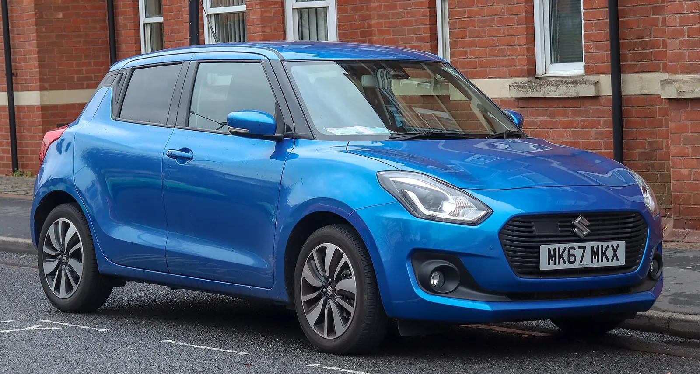

*Foto: Vauxford, [Wikimedia Commons](https://commons.wikimedia.org/wiki/File:2018_Suzuki_Swift_SZ5_Boosterjet_SHVS_1.0_Front.jpg), licență [CC BY-SA 4.0](https://creativecommons.org/licenses/by-sa/4.0/deed.ro). Fotografie redimensionată.*

### Skoda Fabia (din 2021, a patra generație)

Proprietarii britanici îi dau 97,5% la What Car?, iar la ADAC Fabia apare printre modelele fiabile în toți anii din statistică (acolo intră mai ales generația anterioară). Pe Autovit sunt 40 de anunțuri din 2022–2024, cu un median de 9.890 €. Kilometrajul median e însă de 99.000 km, mult pentru o mașină de 2–4 ani.

**Atenție la:** ecranul central. Pe forumul britanic Briskoda, mai mulți proprietari de Fabia 4 scriu că ecranul se stinge și repornește; unuia i s-a schimbat unitatea, altul a primit 90% reducere de la dealer pentru reparație ([Briskoda](https://www.briskoda.net/forums/topic/534312-infotainment-fabia-22-plate/)). La proba de drum, ține mașina pornită cu telefonul conectat câteva minute.

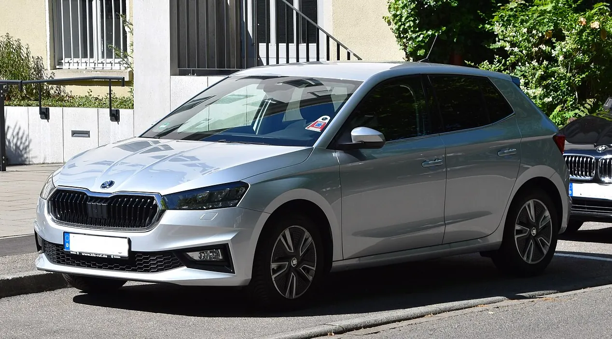

*Foto: Charles from Port Chester, New York, [Wikimedia Commons](https://commons.wikimedia.org/wiki/File:%C5%A0koda_Fabia_IV_1.0_MPI_(2022)_(52197085072).jpg), licență [CC BY 2.0](https://creativecommons.org/licenses/by/2.0/deed.ro). Fotografie decupată și redimensionată.*

**Mai merită pomenită:** Mazda 2 pe benzină (2015–2025) iese la fel de bine la TÜV și ADAC, dar pe Autovit am găsit doar 5 anunțuri din 2016–2019.

**Dacă găsești unul:** Mercedes B-Klasse e singurul model în top 10 TÜV la toate cele șase vârste. Pe Autovit am găsit însă doar 10 B 180 din 2015–2018, în jur de 8.500 €, cu 189.000 km în medie, și 7 din 2019–2022.

## Second hand 10.000–15.000 €

### Mazda CX-3 (benzină, din 2015)

E câștigătorul TÜV la mașinile de 8–9 ani: doar 9,7% au picat inspecția cu defecte grave, față de o medie de 18,3% la vârsta asta. La 6–7 ani e pe locul 5. La ADAC a avut pane puține în toți anii din statistică.

Pe Autovit am găsit 14 anunțuri pe benzină din 2016–2019, cu un preț median de 13.200 € și 101.000 km. Cu toate motorizările sunt 37, cu un median de 10.500 €, pentru că cele diesel sunt mai ieftine.

**Atenție la:** spațiu. E un SUV mic, cu portbagaj mic și bancheta strâmtă. Datele TÜV și ADAC nu separă motoarele, dar varianta pe benzină 2.0 nu are filtru de particule, care la diesel se înfundă pe drumuri scurte.

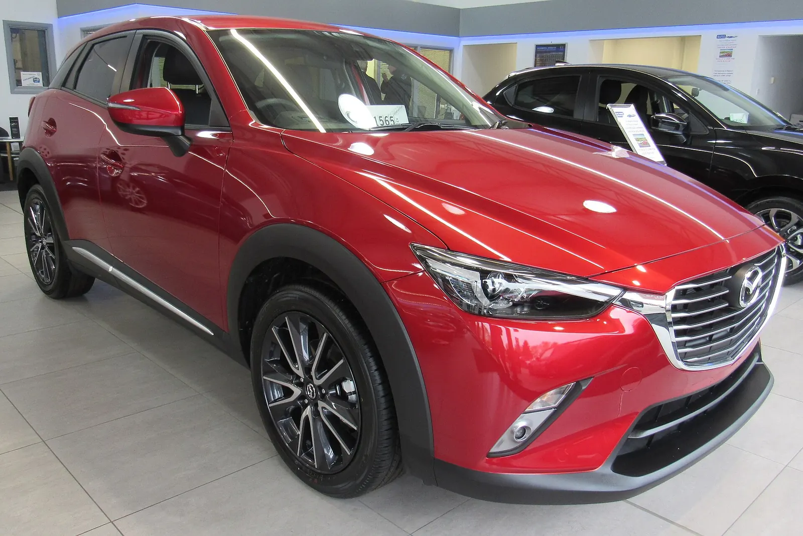

*Foto: Vauxford, [Wikimedia Commons](https://commons.wikimedia.org/wiki/File:2017_Mazda_CX-3_SKYACTIV-G_2.0_Front.jpg), licență [CC BY-SA 4.0](https://creativecommons.org/licenses/by-sa/4.0/deed.ro). Fotografie redimensionată.*

### Suzuki Vitara (din 2015)

Vitara apare în top 10 la TÜV la două vârste: locul 8 la 6–7 ani (8,7%) și locul 5 la 8–9 ani (11,4%). La ADAC are între 2,8 și 6,2 pane la 1.000 de mașini, cifre mici în toți anii. La What Car? are 95,4%.

Pe Autovit: 35 de anunțuri din 2016–2021, cu un median de 12.000 € și 138.000 km.

**Atenție la:** motor. Vitara a avut mai multe motoare: 1.6 pe benzină și diesel, 1.0 și 1.4 turbo, 1.4 mild hybrid și, din 2022, 1.5 full hybrid cu cutie robotizată. Datele nu le separă, așa că la cele mai noi motoare istoria e mai scurtă.

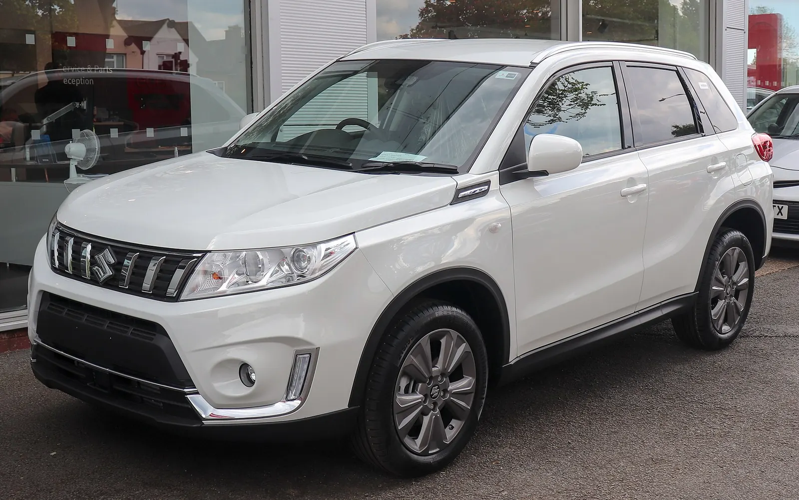

*Foto: Vauxford, [Wikimedia Commons](https://commons.wikimedia.org/wiki/File:2019_Suzuki_Vitara_facelift_Front.jpg), licență [CC BY-SA 4.0](https://creativecommons.org/licenses/by-sa/4.0/deed.ro). Fotografie redimensionată.*

### Kia Ceed (din 2018, a treia generație)

Ceed-ul din 2018–2025 are 98,8% la What Car?, cea mai bună notă dintre compacte. La ADAC e doar mediu. Pe Autovit sunt 37 de anunțuri din 2018–2021, cu un median de 11.000 € și 130.000 km.

**Atenție la:** generație. Ceed-ul și Hyundai i30 de dinainte de 2018 sunt printre ultimele 10 la TÜV la 10–11 ani, iar i30 și la 12–13 ani. Nota bună e a generației din 2018.

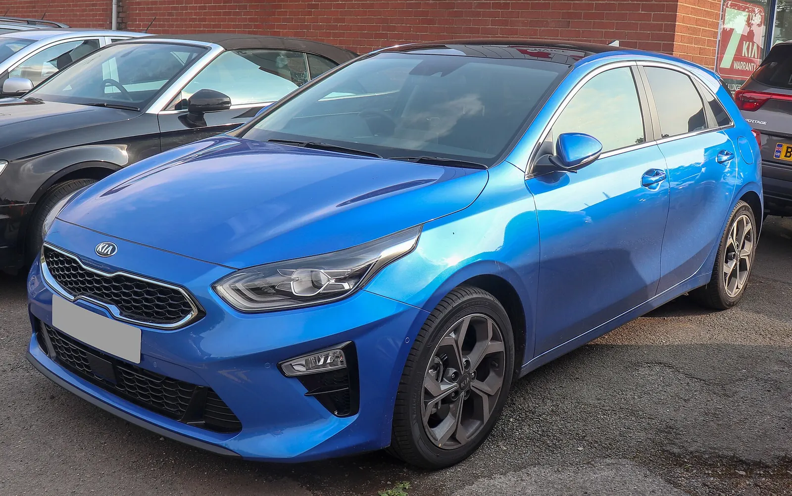

*Foto: Vauxford, [Wikimedia Commons](https://commons.wikimedia.org/wiki/File:2018_Kia_Ceed_First_Edition_ISG_1.4_Front.jpg), licență [CC BY-SA 4.0](https://creativecommons.org/licenses/by-sa/4.0/deed.ro). Fotografie redimensionată.*

### Audi Q2 (din 2016)

E pe locul 3 la TÜV la 4–5 ani și la 6–7 ani, are 98,5% la What Car? și pane puține la ADAC. Pe Autovit: 31 de anunțuri din 2017–2020, cu un median de 14.000 €.

**Atenție la:** kilometraj. Q2-urile de pe Autovit au în medie 185.000 km, mult peste celelalte modele din listă.

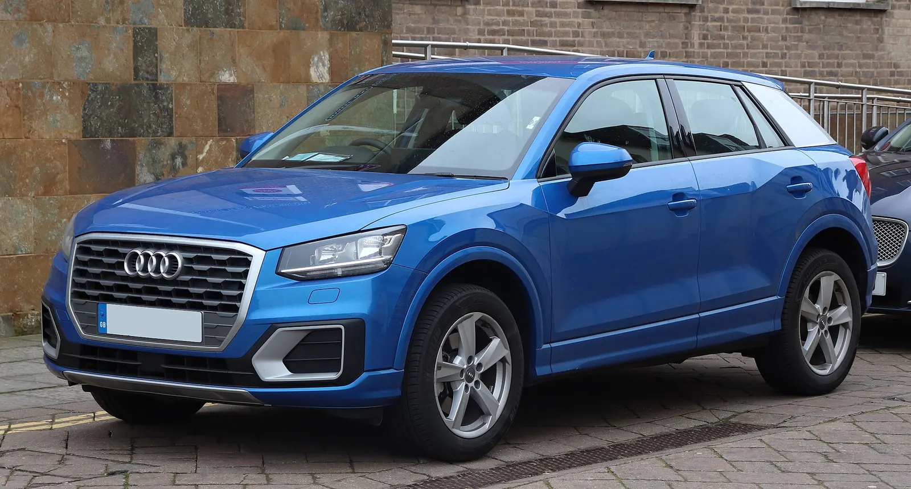

*Foto: Vauxford, [Wikimedia Commons](https://commons.wikimedia.org/wiki/File:2017_Audi_Q2_Sport_TDi_1.6_Front.jpg), licență [CC BY-SA 4.0](https://creativecommons.org/licenses/by-sa/4.0/deed.ro). Fotografie redimensionată.*

## Second hand 15.000–20.000 €

### Volkswagen T-Roc (prima generație)

T-Roc e cel mai constant model din TÜV 2026: locul 1 la 6–7 ani (6,7%), primul la egalitate la 4–5 ani și pe locul 2 la 2–3 ani. La What Car? are 99,0%, iar la ADAC are pane puține în toți anii.

Pe Autovit: 76 de anunțuri din 2018–2021, cu un median de 15.900 € și 123.000 km.

**Atenție la:** smuciturile la plecarea de pe loc. La 1.5 TSI din primii ani, proprietarii au raportat smucituri în treapta 1, atât pe manual, cât și pe DSG, iar actualizările de software nu le-au rezolvat la toți ([forum T-Roc Italia](https://www.t-roc.it/viewtopic.php?p=25766)). Fă proba de drum cu motorul rece și cu manevre lente. La motoarele mici pe benzină, cutia automată e de obicei DSG cu 7 trepte și ambreiaj uscat (DQ200), cea despre care am scris în [recenzia Superb-ului meu](/recenzii/skoda-superb-2020-pareri-proprietar/).

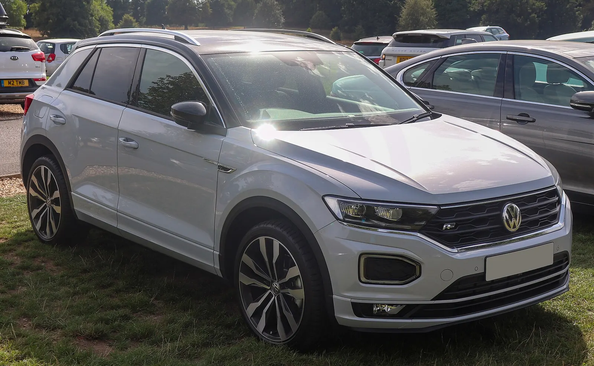

*Foto: Vauxford, [Wikimedia Commons](https://commons.wikimedia.org/wiki/File:2018_Volkswagen_T-Roc_R-Line_TSi_EVO_S-A_1.5_Front.jpg), licență [CC BY-SA 4.0](https://creativecommons.org/licenses/by-sa/4.0/deed.ro). Fotografie redimensionată.*

### Skoda Karoq (din 2017)

La TÜV, Karoq e pe locul 4 la 6–7 ani (7,8%). La ADAC are între 3,2 și 7,7 pane la 1.000 de mașini, iar la What Car? are 95,5%. Pe Autovit sunt 90 de anunțuri din 2018–2021, cu un median de 17.000 € și 155.000 km.

**Atenție la:** aceleași motoare și cutii ca la T-Roc. Pe benzină cu automată, verifică ce DSG are mașina și ce s-a făcut la ea în service.

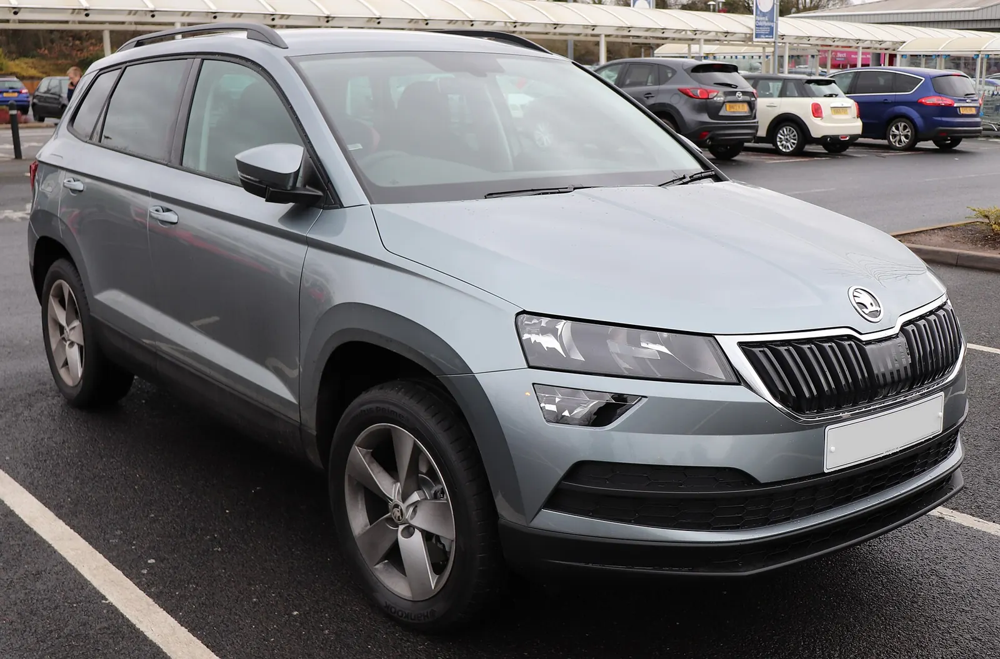

*Foto: Vauxford, [Wikimedia Commons](https://commons.wikimedia.org/wiki/File:2018_Skoda_Karoq_SE_TSi_S-A_1.0_Front.jpg), licență [CC BY-SA 4.0](https://creativecommons.org/licenses/by-sa/4.0/deed.ro). Fotografie redimensionată.*

### Mazda CX-5 pe benzină (2017–2025)

What Car? dă note separate pe motorizări: 98,4% pentru CX-5 pe benzină și 94,9% pentru diesel. La ADAC, CX-5 apare printre modelele fiabile în toți anii. Pe Autovit sunt 32 de anunțuri pe benzină din 2017–2021, cu un median de 19.900 € și 120.000 km.

**Atenție la:** motorizare. Peste jumătate din CX-5 de pe Autovit din acești ani nu sunt pe benzină, ci în mare parte diesel 2.2 (77 de anunțuri cu toate motoarele, cu un median de 16.000 €). Datele sunt mai bune pentru benzină, care e și mai scumpă.

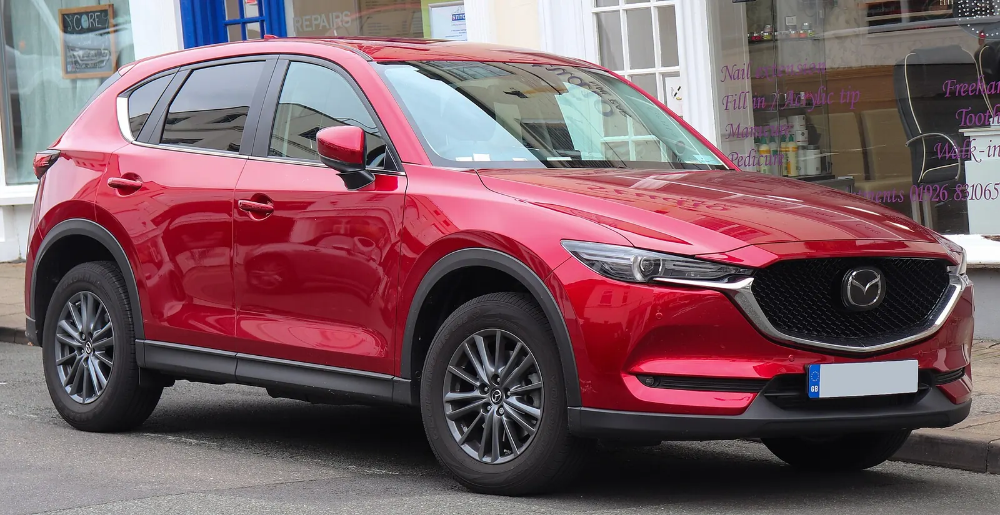

*Foto: Vauxford, [Wikimedia Commons](https://commons.wikimedia.org/wiki/File:2019_Mazda_CX-5_SE-L_NAV%2B_Diesel_2.2_Front.jpg), licență [CC BY-SA 4.0](https://creativecommons.org/licenses/by-sa/4.0/deed.ro). Fotografie redimensionată.*

### Toyota Corolla hibrid (din 2019)

Corolla are 96,5% la What Car?, iar Toyota e pe locul 3 la TÜV pe mărci, la mașinile de 10–11 ani. ADAC o trece însă pe lista problemelor pentru anul 2023, din cauza bateriei de 12 V (detalii mai jos).

Pe Autovit sunt 93 de anunțuri din 2019–2021, cu un median de 17.000 € și 124.000 km, și 96 din 2022–2024, cu un median de 18.000 € și 108.000 km.

**Atenție la:** kilometraj și baterie. Peste 100.000 km la o mașină de 2–4 ani înseamnă mult condus. Verifică istoricul și cere un test al bateriei de 12 V.

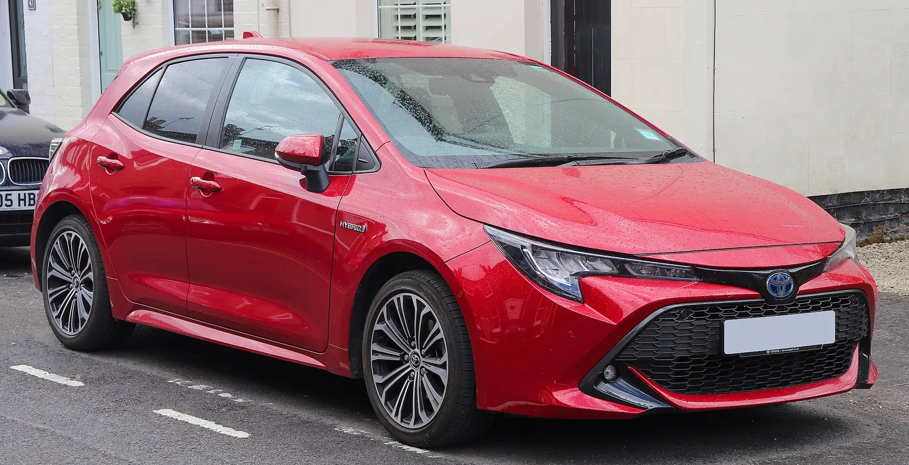

*Foto: Vauxford, [Wikimedia Commons](https://commons.wikimedia.org/wiki/File:2019_Toyota_Corolla_Design_VVT-i_HEV_1.8_Front.jpg), licență [CC BY-SA 4.0](https://creativecommons.org/licenses/by-sa/4.0/deed.ro). Fotografie redimensionată.*

**Alternativă, cu rezerve:** Mazda3 pe benzină (din 2019) are kilometraje mai mici pe Autovit (33 de anunțuri din 2019–2022, cu un median de 16.500 € și 85.000 km), dar doar 90,8% la What Car?, iar ADAC trece anul 2020 pe lista problemelor.

## Second hand 20.000–30.000 €

### Kia Sportage (din 2022, a cincea generație)

Sportage-ul nou e pe locul 8 la TÜV la 2–3 ani (4,0%) și are 96,5% la What Car?, pe benzină și hibrid. Pe Autovit sunt 116 anunțuri din 2022–2024, cu un median de 22.300 € și 103.000 km.

**Atenție la:** generație. Sportage-ul din 2016–2021 are doar 72,9% la What Car?, al doilea cel mai slab SUV de familie din sondaj. E și mult mai des întâlnit: 236 de anunțuri, în jur de 15.400 €. Varianta plug-in hybrid a generației noi are și ea doar 90,1%.

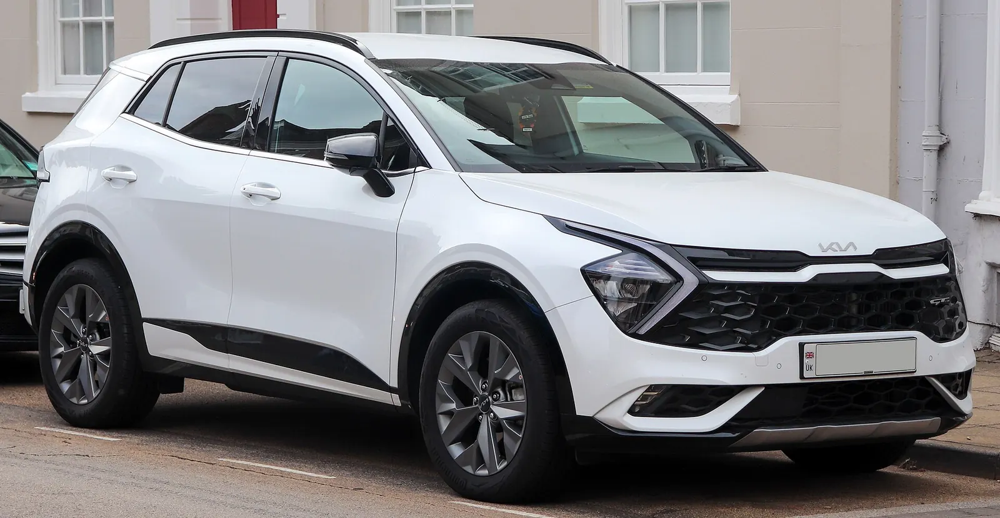

*Foto: Vauxford, [Wikimedia Commons](https://commons.wikimedia.org/wiki/File:2022_Kia_Sportage_GT-Line_ISG_HEV_Automatic_1.6_Front.jpg), licență [CC BY-SA 4.0](https://creativecommons.org/licenses/by-sa/4.0/deed.ro). Fotografie redimensionată.*

### Cu mai puține date

- **Honda CR-V (din 2018):** 95,5% la What Car?, iar Honda e a doua marcă în sondaj; nu am date TÜV sau ADAC pe model. Pe Autovit: 25 de anunțuri din 2018–2022, cu un median de 22.850 €.
- **Hyundai Tucson (din 2021):** 94,3% la What Car?, fără alte date pe generația asta. Pe Autovit: 217 anunțuri din 2021–2023, cu un median de 22.500 €.
- **Toyota RAV4 hibrid (din 2019):** 98,9% la What Car?, dar cel mai slab din clasa lui la ADAC în 2017–2022, din cauza bateriei de 12 V. Pe Autovit: 50 de anunțuri din 2019–2021, cu un median de 25.000 € și 149.000 km.

## Mașini noi sub 30.000 €

La o mașină nouă nu există încă date de fiabilitate: TÜV o vede prima dată după trei ani. Ce poți judeca e cum s-a descurcat generația anterioară sau același motor și cât de lungă e garanția. Prețurile de mai jos sunt de pe site-urile oficiale din România, cu TVA, pe 1 noiembrie 2026. Unele includ promoții care pot expira.

| Model | Preț de la | De ce | Atenție |
| --- | --- | --- | --- |
| Suzuki Swift | 16.910 € | Suzuki e prima marcă la What Car? 2026 | generație nouă din 2024, încă fără date |
| Skoda Fabia | 17.281 € | 97,5% la What Car?; fiabilă la ADAC | ecranul central (vezi mai sus) |
| Skoda Kamiq | 19.733 € | fiabil la ADAC; 94,1% la What Car? | – |
| Kia Stonic | 19.917 € după promoție | 96,4% la What Car?; garanție 7 ani | prețul de listă e 21.417 € |
| Suzuki Vitara | 22.125 € | bine la TÜV, ADAC și What Car? | versiunea full hybrid are altă cutie |
| Toyota Corolla sedan hibrid | 22.918 € după promoție | 96,5% la What Car?; garanție până la 10 ani, cu revizii la Toyota | bateria de 12 V (vezi mai jos); cea de 22.507 € e pe benzină |
| Toyota Yaris Cross | 23.616 € | locul 4 la TÜV la 2–3 ani | pe lista problemelor ADAC în 2022–2023 |
| Mazda2 Hybrid | 23.680 € | Mazda 2 câștigă TÜV 2026; e un Yaris cu sigla Mazda | TÜV nu spune clar dacă premiul e al hibridului |
| Honda Jazz hibrid | 25.990 € | 97,1% la What Car? | simulatorul de frână la cele din 2020–2022 (vezi mai jos) |
| Kia Sportage | 26.308 € după promoție | locul 8 la TÜV la 2–3 ani; garanție 7 ani | fără promoție, 32.308 € |
| Toyota Corolla hatchback hibrid | 26.835 € | ca la sedan | ca la sedan |

Surse: [Toyota](https://www.toyota.ro/new-cars), [Skoda](https://www.skoda.ro/models/overview), [Suzuki](https://d2m726zkydqemy.cloudfront.net//Lista%20preturi_01.10.2026.pdf), [Kia](https://www.kia.ro/), [Mazda](https://www.mazda.ro/modele/), [Honda](https://hondatrading.ro/). Prețurile nu includ ecotichetul Rabla. Programul pentru persoane fizice e deschis până pe 31 decembrie 2026 sau până se termină banii ([Wall-Street.ro](https://www.wall-street.ro/articol/auto/programul-rabla-2026-pentru-persoane-fizice-incepe-pe-20-iulie.html)).

**Honda Jazz și simulatorul de frână:** în decembrie 2023, Honda a anunțat în Japonia o remediere pentru mașini produse între iulie 2018 și martie 2022, printre care și Jazz (Fit). Senzorul de presiune din simulatorul de frână se poate coroda, se aprinde un martor și pedala devine mai grea; remedierea e un simulator nou ([Honda Japonia](https://www.honda.co.jp/recall/auto/info/231208_683.html)). În Marea Britanie, proprietarii de Jazz hibrid din 2020 au primit scrisori că piesa se schimbă gratuit ([ClubJazz](https://clubjazz.org/forum/index.php?topic=17262.0)). Un Jazz nou, produs după martie 2022, nu intră în această remediere; la unul second hand, cere la dealer verificarea după VIN.

**Dacia Duster nou, de la 19.500 €:** e cel mai ieftin SUV, iar What Car? îi dă 95% Duster-ului din 2018 încoace, la mașini de până la 5 ani. La TÜV însă, Duster-ul e ultimul la 6–7 ani și la 10–11 ani (vezi mai jos). Duster 3, din 2024, nu are încă date.

## Mașini populare care nu ies bine

- **Dacia Duster și Sandero după 6 ani:** la TÜV, Duster e ultimul din 95 de modele la 6–7 ani (23,5% picate), penultimul la 8–9 ani (29,8%) și ultimul din 84 la 10–11 ani (34,2%). Sandero e printre ultimele trei la 8–9 și 12–13 ani. Nu înseamnă neapărat că se strică motorul: TÜV numără ce pică inspecția (frâne, suspensie, direcție, lumini). Dar înseamnă mai multe reparații la fiecare ITP. Și în sondajul Driver Power, Dacia e a patra cea mai puțin fiabilă marcă.
- **Kia Sportage 2016–2021:** 72,9% la What Car?, deși generația următoare are 96,5%.
- **Ford Focus:** printre ultimele 5 la TÜV la 8–9 ani, iar generația 2018–2026 are 87,3% la What Car?.
- **Hyundai i30 și Kia Ceed de dinainte de 2018:** printre ultimele 10 la TÜV la 10–11 ani; i30 și la 12–13 ani.
- **Skoda Octavia 4 și VW Golf 8 (din 2020):** nu sunt la coada TÜV, dar la What Car? au doar 89,5% și 82,2%, în a doua jumătate a clasamentului compactelor.
- **Nissan Juke pe benzină (din 2019):** 55,2% la What Car?, ultimul dintre SUV-urile mici.

Și mașina mea apare într-un clasament prost: TÜV pune Skoda Superb de 2–3 ani pe locul 101 din 110 (9,6% picate). Pe al meu l-am cumpărat cu 80.000 km, iar în aproape 40.000 km nu s-a stricat nimic important ([recenzia](/recenzii/skoda-superb-2020-pareri-proprietar/)). Nu e o contradicție: TÜV numără ce pică la inspecție, nu ce te lasă pe drum, iar o singură mașină nu face o statistică.

## Toyota: fiabilă, dar verifică bateria de 12 V

De trei ani, ADAC trece mai multe modele Toyota printre cele care rămân cel mai des în pană: C-HR, RAV4, Yaris, Yaris Cross și Corolla din 2023. Cauza e bateria mică de 12 V, cea care pornește sistemele mașinii, nu bateria mare a hibridului.

Toyota a răspuns că le înlocuiește în garanție din februarie 2024 și că montează baterii mai mari: la Yaris și Yaris Cross din producția din noiembrie 2024, la Corolla și C-HR din februarie 2026. La RAV4 a făcut un update de software în februarie 2025. Toyota spune că la Yaris și Yaris Cross produse din noiembrie 2024 cazurile în garanție au scăzut cu peste 90%. ADAC notează că în statistica din 2025 cifrele erau tot foarte mari ([ADAC](https://www.adac.de/rund-ums-fahrzeug/unfall-schaden-panne/adac-pannenstatistik-2026/)).

Pentru cumpărător, concluzia e simplă: nu e un motiv să ocolești Toyota, ci să verifici bateria. La o Toyota hibridă second hand, cere un test al bateriei de 12 V și întreabă dacă a fost schimbată. Dacă mașina stă des zile întregi fără să fie condusă, un încărcător de întreținere ajută.

## Ce verifici la orice mașină second hand

Un model fiabil nu garantează un exemplar bun. Înainte să plătești:

1. **Kilometrajul:** RAR eliberează certificatul RAR Auto-Pass, cu istoricul kilometrajului, pentru 42 de lei, doar de pe [rarom.ro](https://www.rarom.ro/?p=298753). Compară-l cu cartea de service.
2. **Kilometraj mare pentru vârstă:** la Corolla hibrid și Fabia, medianele de pe Autovit ajung la aproximativ 100.000 km la mașini de 2–4 ani. Nu e neapărat rău, dar cere istoricul complet.
3. **Bateria de 12 V la hibride:** cere un test, mai ales la Toyota.
4. **Cutia automată:** la VW și Skoda pe benzină, află ce DSG are mașina (DQ200 cu ambreiaj uscat sau una cu ambreiaje în baie de ulei) și ce s-a făcut la ea în service.
5. **Campaniile de service:** un dealer autorizat poate verifica după VIN dacă mașina are campanii nerezolvate.
6. **Inspecția:** du mașina la un mecanic ales de tine, nu de vânzător.

## Întrebări frecvente

**Care e cea mai fiabilă mașină second hand sub 10.000 €?** În datele din 2026, Suzuki Swift 2017–2024: 100% la What Car?, în top 10 TÜV la 6–7 ani și pane puține la ADAC, la aproximativ 10.000 €. Se găsește însă greu. Skoda Fabia din 2022 încoace costă cam la fel și se găsește mai ușor, dar verifică ecranul central și kilometrajul. Dacă poți ajunge la 13.000 €, Mazda CX-3 pe benzină e prima la TÜV la 8–9 ani.

**Toyota mai e cea mai fiabilă marcă?** Depinde de sursă. La TÜV, Toyota e pe locul 3 la mașinile de 10–11 ani, iar la Driver Power pe locul 5. La What Car? e doar a 17-a din 30, iar ADAC trece mai multe modele Toyota printre cele care rămân cel mai des în pană, din cauza bateriei de 12 V. Hibridul în sine are o reputație bună.

**Dacia e o mașină fiabilă?** Când e nouă, destul de bine: Duster-ul din 2018 încoace are 95% la What Car?. După 6 ani însă, Duster și Sandero sunt printre ultimele modele la TÜV, iar Driver Power pune Dacia printre cele mai puțin fiabile mărci. E o mașină ieftină și simplă, dar nu una dintre cele mai fiabile.

**Ce mașină nouă fiabilă iei cu sub 30.000 €?** Suzuki Swift sau Vitara, Skoda Fabia sau Kamiq, Toyota Corolla sau Yaris Cross hibrid și Kia Sportage în promoție au cele mai bune argumente: modele anterioare bine clasate și, la Toyota și Kia, garanții lungi.

**De ce clasamentele de fiabilitate nu se potrivesc între ele?** Pentru că măsoară lucruri diferite. TÜV numără defectele care te pică la ITP-ul german, ADAC panele pe drum, iar What Car? ce spun proprietarii despre mașinile de până la 5 ani. Toyota RAV4, de exemplu, are 98,9% la What Car? și e cel mai slab din clasa lui la ADAC.

**De ce nu folosiți Consumer Reports sau J.D. Power?** Pentru că sunt sondaje din Statele Unite, cu modele și motoare care nu se vând în Europa. Pentru o mașină cumpărată în România, datele din Germania și Marea Britanie sunt mai apropiate.

**Când apare TÜV-Report 2027?** De obicei, TÜV publică raportul în a doua jumătate a lui noiembrie; ediția 2026 a apărut pe 20 noiembrie 2025. Actualizez articolul după ce apare.
