Am cumpărat second hand un Skoda Superb 2020 cu motorul 2.0 TSI de 272 CP, tracțiune integrală și cutie DSG cu 7 trepte, când avea 80.000 km la bord. Acum se apropie de 120.000 km. Pe scurt: pentru banii ăștia e greu să găsești o combinație mai bună de viteză, confort și spațiu, iar în aproape 40.000 km nu s-a stricat nimic important. Mai jos găsești ce îmi place, ce nu, cât consumă în realitate și ce să verifici dacă vrei să cumperi unul second hand.

**Pe scurt**

- **Îmi place:** puterea, confortul și spațiul; în aproape 40.000 km nu s-a stricat nimic important
- **Nu îmi place:** jantele de 19" (anvelope scumpe, zgomot, risc de tăiere în gropi), lipsa Apple CarPlay wireless, vopseaua neagră care nu stă curată niciodată
- **Consum real:** 9–10 l/100 km pe drum lung, 12–13 l/100 km în oraș
- **Nota mea:** 7,8/10 (media notelor din verdict)

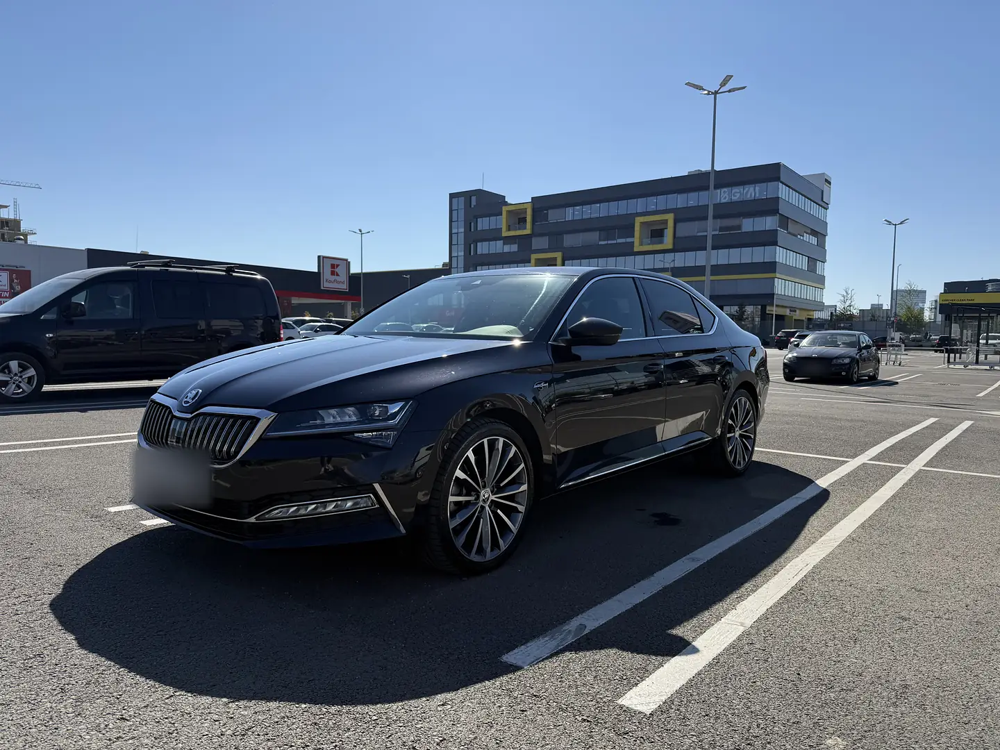

## Ce versiune am: Superb 3 facelift, 2.0 TSI 272 CP 4x4

Mașina mea este a treia generație de Superb, în varianta facelift lansată în 2019. Versiunea de 272 CP cu 4x4 și DSG a fost vândută în 2019–2020; ulterior, Skoda a revenit la 280 CP pe același motor 2.0 TSI. Echiparea mea este Laurin & Klement, cu caroseria liftback (cea cu aspect de sedan), și are aproape tot ce se putea comanda: sistem audio Canton, suspensie adaptivă DCC, scaune față încălzite și ventilate și asistent de parcare care parchează mașina singur. Singura opțiune care îi lipsește este plafonul panoramic.

| Specificație | Valoare |
| --- | --- |
| Motor | 2.0 TSI (EA888), 4 cilindri, 1.984 cm³, benzină |
| Putere | 272 CP la 5.500–6.500 rpm |
| Cuplu | 350 Nm la 2.000–5.400 rpm |
| Transmisie | DSG cu 7 trepte, tracțiune integrală 4x4 |
| 0–100 km/h | 5,6 s |
| Viteză maximă | 250 km/h (limitată electronic) |
| Consum oficial WLTP (mixt) | 8,0–9,3 l/100 km |
| Rezervor | 66 l |
| Lungime / lățime / înălțime | 4.869 / 1.864 / 1.468 mm |
| Ampatament | 2.841 mm |
| Portbagaj (liftback) | 625 l, până la 1.760 l cu bancheta rabatată |
| Masă proprie | 1.570–1.746 kg |
| Normă de poluare | Euro 6d-TEMP |

Sursa datelor tehnice: [auto-data.net](https://www.auto-data.net/en/skoda-superb-iii-facelift-2019-2.0-tsi-272hp-4x4-dsg-37484).

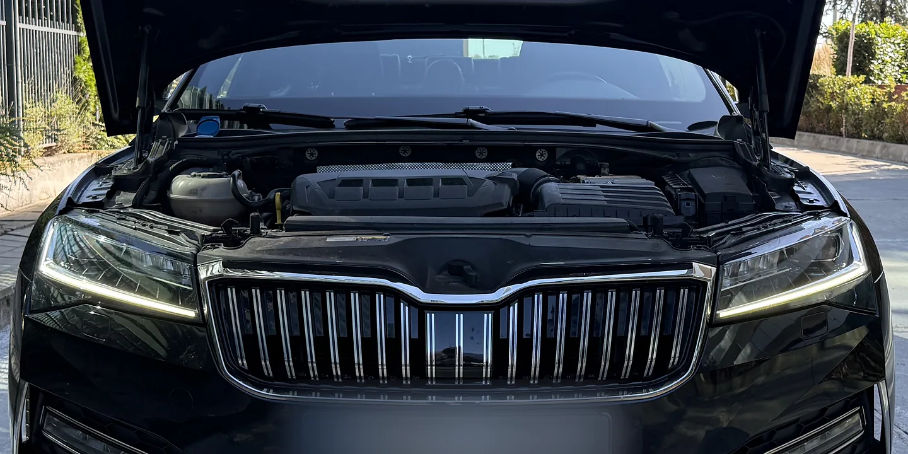

Ce a adus facelift-ul din 2019: Superb a fost primul model Skoda de serie cu faruri Full LED Matrix, care sting doar segmentele ce i-ar orbi pe ceilalți șoferi. Stopurile LED au primit semnalizare dinamică, grila a devenit mai mare, iar mașina a crescut cu 8 mm, la 4.869 mm. Portbagajul a rămas la 625 l (660 l la Combi). Au apărut și Predictive Cruise Control și un Side Assist care vede mașinile până la 70 m în spate. Sportline are ramă neagră lucioasă la grilă și ornamente cu aspect de carbon; Laurin & Klement are mai mult crom și plafon din Alcantara opțional ([sursa: Škoda](https://www.skoda-storyboard.com/en/press-kits/press-kit-skoda-at-the-iaa-2019/upgraded-skoda-superb-full-led-matrix-headlights-provide-a-new-highlight/)).

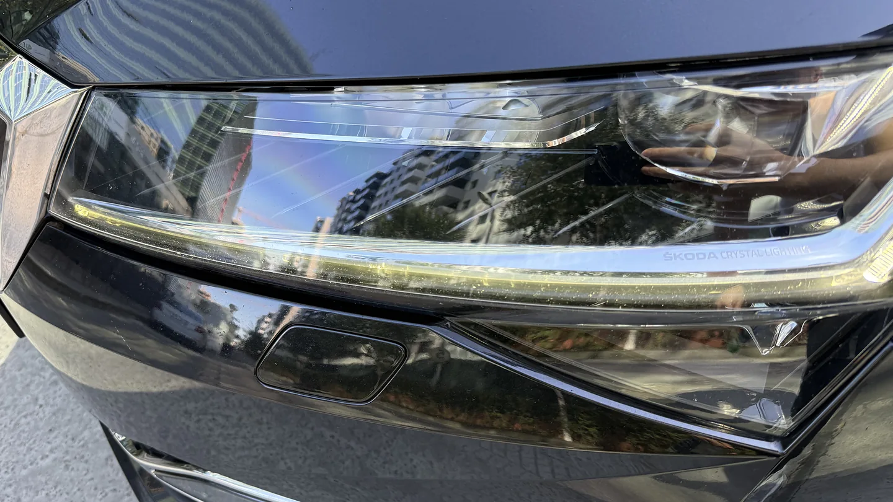

## De ce l-am ales

Am cumpărat mașina din Republica Moldova, unde este și înmatriculată. Alegerea a fost simplă: voiam viteză și confort în aceeași mașină, iar un Superb cu 272 de cai putere și tracțiune integrală le bifează pe amândouă. Prețul a fost bun, așa că n-a fost nevoie să mă gândesc prea mult.

## Cum se conduce: 272 CP și 4x4 în viața de zi cu zi

Pe hârtie, Superb 2.0 TSI 4x4 face 0–100 km/h în 5,6 secunde, iar cuplul maxim de 350 Nm e disponibil de la 2.000 rpm. Puterea e primul lucru care îmi place la ea. Singura limită apare la viteze foarte mari, unde un motor de 2 litri începe să se simtă: mi-ar fi plăcut un 3.0 pe benzină, dar recunosc că aici sunt eu pretențios. La performanță îi dau 7 din 10.

Cutia DSG nu mi-a dat probleme, dar are un obicei care nu îmi place: uneori urcă prea mult în turație înainte să schimbe treapta. Se simte mai ales în oraș, la trecerile din 1 în 2 și din 2 în 3, și la urcare pe munte, unde prefer să trec pe modul manual. Între timp am schimbat uleiul la cutie, cu un kit ZF (detalii mai jos, la costuri), și revin cu o actualizare dacă se schimbă ceva.

Tracțiunea integrală își face treaba: pe ploaie sau pe zăpadă n-am avut nicio problemă și n-am pierdut niciodată aderența. Cu anvelope bune, tracțiunea e excelentă.

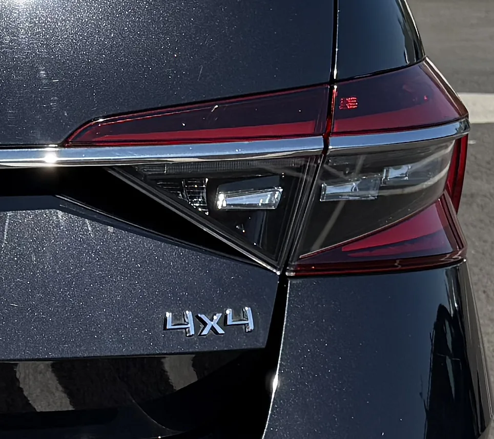

Pe drumuri lungi, Superb e excelentă: stă foarte stabilă chiar și la viteze mari, mai ales cu anvelope bune. Am condus înainte un BMW Seria 7 și un Range Rover, așa că la confort îi dau 8, nu 10. Pentru prețul ei, însă, e un 10. Minusul sunt jantele de 19": pe drumuri care nu sunt perfecte, anvelopele cu profil jos fac destul de mult zgomot.

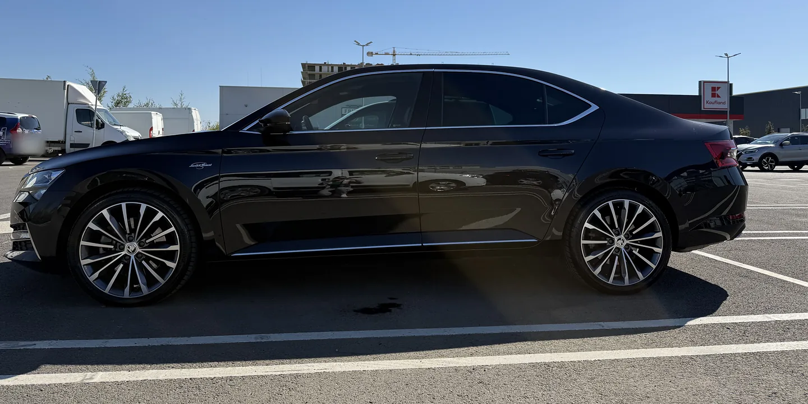

## Consum real: cât consumă la mine

Consumul oficial WLTP pentru această versiune este 8,0–9,3 l/100 km în regim mixt. Iată cât consumă la mine, din experiența celor aproape 40.000 km. Precizez că nu conduc tocmai liniștit.

| Regim | Consum mediu (l/100 km) | Unde |
| --- | --- | --- |
| Oraș | 12–13 | București |
| Drum lung | 9–10 | București–Chișinău |

Consumul e punctul ei slab, așa că aici îi dau 6 din 10. Cu stilul meu de condus, un plin de 66 de litri ține cam 500 km.

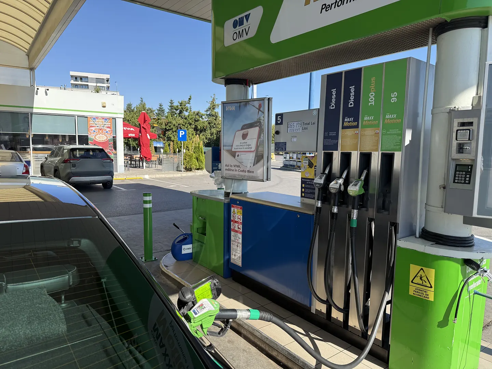

## Spațiu și portbagaj

Superb are 4.869 mm lungime și un ampatament de 2.841 mm, iar asta se simte mai ales pe bancheta din spate. Portbagajul liftback are 625 l și ajunge la 1.760 l cu bancheta rabatată; varianta Combi are 660 l.

În mașină încap cinci bărbați adulți destul de confortabil.

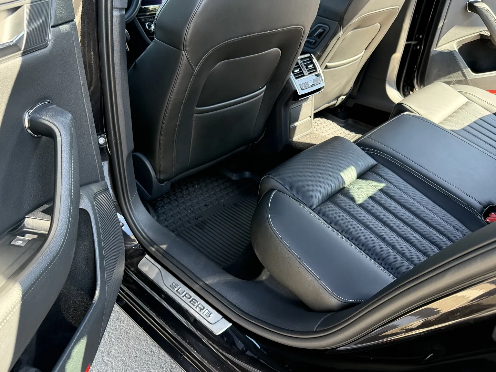

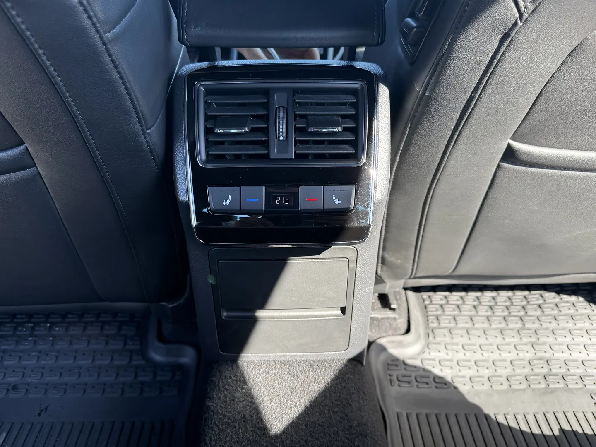

Portbagajul l-am testat serios, la două mutări: Cluj–Chișinău și apoi Chișinău–București. Cu bancheta rabatată am încărcat o placă de gresie de 120 × 60 cm și tot a mai rămas loc pentru bagaje. La spațiu îi dau 9 din 10.

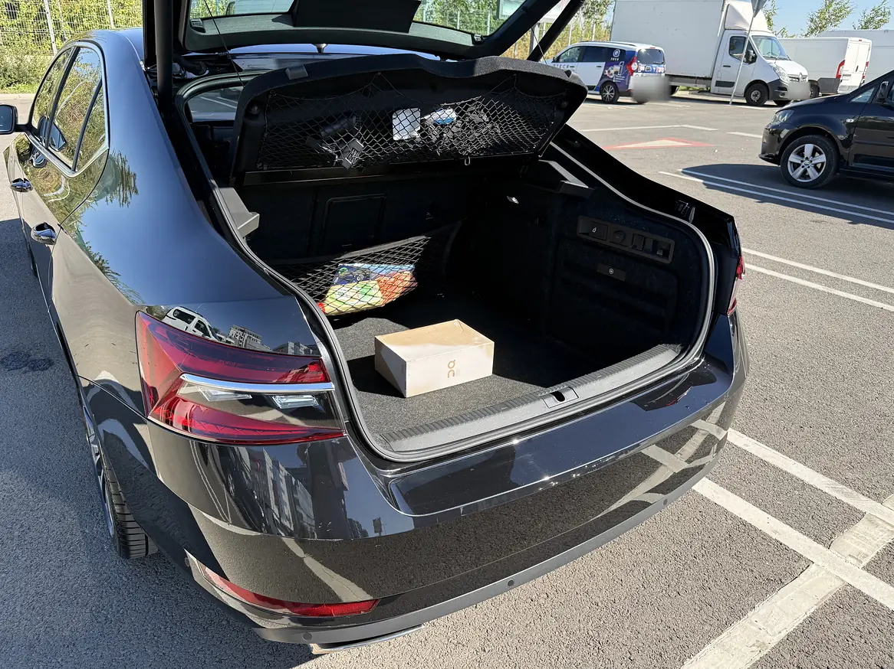

## Interior și tehnologie

Echiparea Laurin & Klement are tot ce îți trebuie: sistem audio Canton, bord digital Virtual Cockpit, scaune față încălzite și ventilate și un asistent care parchează mașina singur. Două lucruri m-au deranjat. Primul: nu are Apple CarPlay wireless, doar prin cablu. Al doilea: rotițele de volum de pe volan s-au crăpat, iar ca să le înlocuiești trebuie schimbat tot butonul, nu doar rotița din plastic. Am cumpărat deja piesele, aștept butoanele și le schimb cum am timp. Până atunci nu pot folosi comenzile de pe volan.

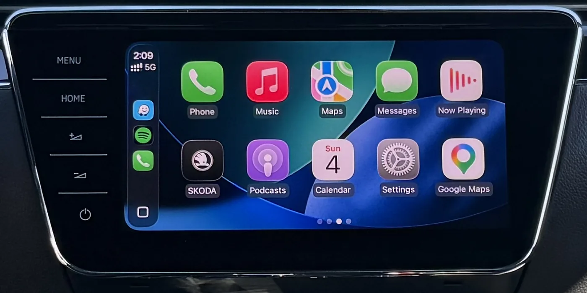

## Probleme și fiabilitate

În aproape 40.000 km nu s-a stricat nimic important, așa că la fiabilitate îi dau 9 din 10. Au fost însă câteva lucruri mici, dar enervante:

- **Jantele de 19" și anvelopele 235/40 R19:** arată foarte bine, dar nu sunt practice. Anvelopele sunt mai scumpe decât cele de 17" sau 18", fac zgomot pe drumuri proaste și se taie ușor în gropi. Mie mi s-a întâmplat de două ori: o dată anvelopa s-a tăiat complet, a doua oară am putut-o repara. Partea bună: cu anvelope de calitate, aderența e excelentă.
- **Rotițele de volum de pe volan s-au crăpat:** nu se schimbă separat, doar cu tot butonul. Piesele sunt comandate.
- **Pilotul automat adaptiv (ACC) și bateria:** când bateria începe să se descarce, ACC-ul nu mai funcționează, iar senzorul radar din față se oprește și el. Dacă ACC-ul refuză să pornească, verifică întâi bateria.
- **Vopseaua neagră:** nu e un defect, dar nu stă curată niciodată.

Iată ce semnalează rapoartele de fiabilitate pentru Superb 3 cu 2.0 TSI ([Car Checker](https://www.carchecker.pro/reports/skoda_superb_mk3_2.0_tsi.html), actualizat în august 2026). Costurile sunt estimări și pot diferi în service-urile din România.

- **Cutia DSG cu 7 trepte (DQ381):** defecte de mecatronică, de obicei între 60.000 și 100.000 km. Semne: șocuri între treptele 1 și 2, cuplare întârziată. Reparație: 1.200–3.500 €.
- **Pompa de apă și carcasa termostatului:** carcasa din plastic se deformează și pierde antigel, de obicei la 60.000–120.000 km. Semne: miros dulceag, martorul de antigel aprins. Reparație: 600–1.200 €.
- **Consumul de ulei:** peste 0,5 l la 1.000 km merită investigat.
- **Lanțul de distribuție:** la peste 150.000 km, un zgomot scurt la pornirea la rece arată uzura întinzătorului. Reparație: 1.500–4.000 €.
- **Hayonul electric:** amortizoarele electrice pot ceda. Înlocuire: 600–800 € perechea.
- **Jantele diamantate:** lacul se poate coji după 2–4 ani; problema e doar estetică.

## Ce spun alți proprietari pe forumuri

Am citit discuțiile proprietarilor de Superb 3 cu 2.0 TSI 4x4 de pe forumuri din România și din Marea Britanie. Concluzia generală seamănă cu a mea: mașina e foarte apreciată, cu condiția să nu faci economie la întreținere.

- **Motorul și cutia țin, dacă sunt întreținute:** pe [Briskoda](https://www.briskoda.net/forums/topic/520441-thoughts-on-superb-4x4-280/), un proprietar spune că motorul și DSG-ul au mers fără probleme timp de peste 160.000 km, cu service regulat. Un altul o numește „cea mai bună mașină pe care am avut-o”. Sfatul care se repetă: nu sări peste reviziile la DSG și la 4x4.
- **Cutia DQ381 nu e DSG-ul cu probleme:** versiunile de 272 și 280 CP au cutia DSG cu 7 trepte și ambreiaje în baie de ulei (DQ381). Pe [Briskoda](https://www.briskoda.net/forums/topic/514323-which-dsg-gearbox-is-fitted-to-a-2020-model-year-superb-sportline-plus-280/), proprietarii subliniază că DSG-ul cu probleme a fost DQ200, cu ambreiaj uscat, montat pe motoarele mici. Tot acolo spun că intervalul oficial de schimb al uleiului la cutie a fost prelungit, dar recomandă să nu aștepți până la limită.
- **Ce se strică totuși:** pe același forum apar des pompa de apă, arcurile, amortizoarele și senzorii de nivel ai suspensiei, bucșele, senzorii ABS și condensatorul de aer condiționat.
- **Un proprietar din România face ca mine:** pe [Club Skoda România](https://www.clubskoda.ro/threads/skoda-superb-2-0-tsi-4x4-280cp.15044/), un proprietar de Superb 2.0 TSI 4x4 de 280 CP schimbă uleiul și filtrele la fiecare 10.000 km, iar uleiul la cutie și la diferențial la 60.000 km. Singura lui problemă a fost un scârțâit metalic în față, pe frig: după aproximativ 4.500 de lei cheltuiți pe diagnoză și reparații, l-a rezolvat înlocuirea bucșelor și a pivotului de la brațele din față, pentru 570 de lei.
- **Consumul raportat de alții e apropiat de al meu:** proprietarii de pe Briskoda raportează cam 7–9,5 l/100 km pe drum lung și 10–12 l/100 km în oraș. Într-un [test de lungă durată al revistei CAR](https://www.carmagazine.co.uk/car-reviews/long-term-tests/skoda/skoda-superb-estate-280ps-tsi-4x4-2017-long-term-test-review/) (un Superb Combi 280 CP din 2017, cam 11.200 km), media a fost de circa 9,1 l/100 km, față de 7,2 oficial. Revista a observat și că DSG-ul e uneori sacadat și că mașina reacționează lent de pe loc, din cauza sistemului start-stop.
- **Nu toată lumea e convinsă:** un [articol de păreri de pe AproapeMasini](https://aproapemasini.com/2020/04/22/pareri-skoda-superb-iii-2015-2021/) consideră că benzina de peste 200 CP nu prea are sens pe Superb și recomandă 2.0 TDI de 150 CP ca cel mai bun echilibru. Tot acolo sunt semnalate plasticele care încep să scârțâie și problemele de electronică (sistemul multimedia, CarPlay).

Eu înțeleg argumentul pentru diesel, dar dacă vrei și viteză, 2.0 TSI 4x4 e motivul pentru care cumperi un Superb.

## Costuri de întreținere

Mașina e înmatriculată în Republica Moldova, așa că RCA-ul și impozitul meu nu sunt relevante pentru o mașină din România. Costurile de service, în schimb, spun multe. Prețurile de dealer sunt de la dealerul Skoda din Republica Moldova. Unde am plătit în lei moldovenești (MDL), sumele în euro sunt aproximative, la cursul BNM din octombrie 2026 (circa 20 MDL pentru 1 €).

| Lucrare | La dealer | La mecanicul meu | Observații |
| --- | --- | --- | --- |
| Schimb de ulei (revizie) | 300 € | 150 € | exact același ulei |
| Schimb de ulei la cutia DSG | ~500 € | 5.900 MDL (~295 €), cu manoperă | kit ZF 4.900 MDL, manoperă 1.000 MDL |
| Ulei la reductorul unghiular din față | – | 1.100 MDL (~55 €), cu manoperă | ulei G 052 145 S2 |
| Ulei la cuplajul Haldex | ~3.500 MDL (~175 €) | – | programat la dealer |

Ce am făcut la mașină aproape de 120.000 km:

- **Uleiul la cutia DSG:** am folosit kitul ZF 5961.308.278, făcut pentru cutia DQ381 (cod 0GC). Conține 6 l de ulei ZF LifeguardFluid 7.6 DCT, filtrul de ulei și garniturile, iar ZF îl dă ca echivalent pentru uleiul original VW G 055 529 A2 ([catalogul ZF](https://aftermarket.zf.com/en/catalog/search/?term=5961.308.278)). Nu e același ulei ca la vechiul DSG cu 6 trepte (DQ250), care folosește G 052 182.
- **Uleiul la reductorul unghiular:** lângă cutia DSG e un reductor unghiular care trimite puterea spre puntea spate. Are uleiul lui, separat de cel al cutiei, iar mulți mecanici îi spun „diferențialul față”. VW cere aici ulei de transmisie G 052 145 S2 (75W-90), cam 0,9 l. Cifrele sunt din [fișa de capacități VW pentru Golf R](https://static.nhtsa.gov/odi/tsbs/2016/MC-10130147-9999.pdf), care are aceeași platformă MQB și același sistem 4x4; pentru mașina ta, verifică după seria de șasiu.
- **Frânele:** am schimbat discurile și plăcuțele din față cu unele Textar și plăcuțele din spate cu Brembo. Cele din față sunt excelente. Mecanicul m-a avertizat că plăcuțele Brembo din spate pot scârțâi puțin, dar eu n-am auzit niciun sunet.
- **Uleiul la Haldex (urmează):** cuplajul Haldex, care decide cât cuplu ajunge la roțile din spate, are și el uleiul lui. Schimbul e programat la dealer și costă în jur de 3.500 MDL.

Anvelopele de 19" sunt cheltuiala care te surprinde: un set Bridgestone 235/40 R19 m-a costat în jur de 1.000 $. Uleiul de motor trebuie să aibă omologarea VW 504 00 sau 502 00; verifică în carnetul mașinii.

Sfatul meu: dacă ai un mecanic de încredere, fă întreținerea la el, nu la dealer. Eu schimb uleiul la fiecare 10.000 km, nu la 20.000. La 150 € pe schimb, două schimburi la mecanic mă costă cât unul la dealer, iar motorul are mereu ulei proaspăt. La costuri îi dau 8 din 10 cu mecanicul meu și 6 din 10 la dealer.

## Merită să cumperi un Superb 2020 second hand în 2026?

În septembrie 2026, pe [AutoScout24.ro](https://www.autoscout24.ro/lst/skoda/superb/re_2020), Superb-urile din 2020 erau listate între 13.990 și 27.890 €, în funcție de motor și kilometraj. Un exemplar 2.0 TSI 272 CP 4x4 Sportline din octombrie 2020, cu aproximativ 69.600 km, era cerut la 23.970 €.

Ce să verifici înainte să dai banii:

- Istoricul complet de service, inclusiv schimburile de ulei la DSG și la sistemul 4x4.
- Pornirea la rece: ascultă primele 1–2 secunde (lanțul de distribuție).
- Schimbările între 1 și 2 și manevrele cu viteză mică (mecatronica DSG).
- O diagnoză care citește și modulul cutiei DSG. O resetare a adaptărilor făcută înainte de vânzare nu e o reparație.
- Urme de antigel în zona pompei de apă și nivelul din vasul de expansiune.
- Consumul de ulei între revizii (întreabă proprietarul).
- Hayonul electric: deschide-l și închide-l de câteva ori.
- Toate cele patru anvelope: aceeași marcă, același model și uzură apropiată, pentru că la 4x4 contează.
- Jantele și anvelopele de 19": caută tăieturi sau umflături pe flancuri.
- Rotițele de pe volan și pilotul automat adaptiv (ACC): verifică dacă funcționează.
- Kilometrajul: compară-l cu istoricul de service și cu inspecțiile ITP. La o mașină second hand, kilometrii reali contează mai mult decât anul.

## Verdict

Da, l-aș cumpăra din nou. Superb 2.0 TSI 4x4 e pentru cine vrea viteză, confort și mult spațiu la un preț bun și face des drumuri lungi. Nu e alegerea potrivită dacă vrei un consum mic sau dacă nu ai un mecanic de încredere, pentru că la dealer întreținerea devine scumpă.

| Categorie | Nota (din 10) |
| --- | --- |
| Confort | 8 |
| Performanță | 7 |
| Consum | 6 |
| Spațiu | 9 |
| Costuri | 8 (6 la dealer) |
| Fiabilitate | 9 |
| **Media** | **7,8** |

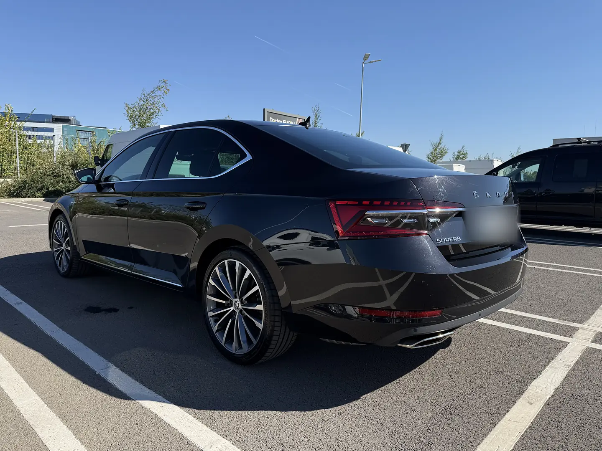

## Întrebări frecvente

**Cât consumă Skoda Superb 2.0 TSI 272 CP?** Oficial, 8,0–9,3 l/100 km în regim mixt (WLTP). Mie îmi iese 9–10 l/100 km pe drum lung și 12–13 l/100 km în oraș, cu un stil de condus destul de sportiv.

**Cât de mare e portbagajul la Skoda Superb 2020?** 625 l la liftback și până la 1.760 l cu bancheta rabatată. Varianta Combi are 660 l.

**Ce dimensiuni are Skoda Superb 2020?** 4.869 mm lungime, 1.864 mm lățime și 1.468 mm înălțime, cu un ampatament de 2.841 mm.

**Ce diferență e între Superb 272 CP și 280 CP?** Ambele folosesc motorul 2.0 TSI cu 4x4 și DSG. Versiunea de 272 CP a fost oferită în 2019–2020, apoi Skoda a revenit la 280 CP.

**Ce ulei folosește Superb 2.0 TSI?** Ulei cu omologare VW 504 00 sau 502 00, în funcție de tipul de interval de service. Verifică în carnetul mașinii.

**Ce ulei intră în cutia DSG la Superb 2.0 TSI 4x4?** Cutia DQ381 (cod 0GC) folosește ulei cu specificația VW G 055 529 A2, cam 6 l la un schimb cu filtru. Eu am folosit kitul ZF 5961.308.278, cu ulei ZF LifeguardFluid 7.6 DCT. Reductorul unghiular din față are ulei separat, G 052 145 S2 (75W-90).
