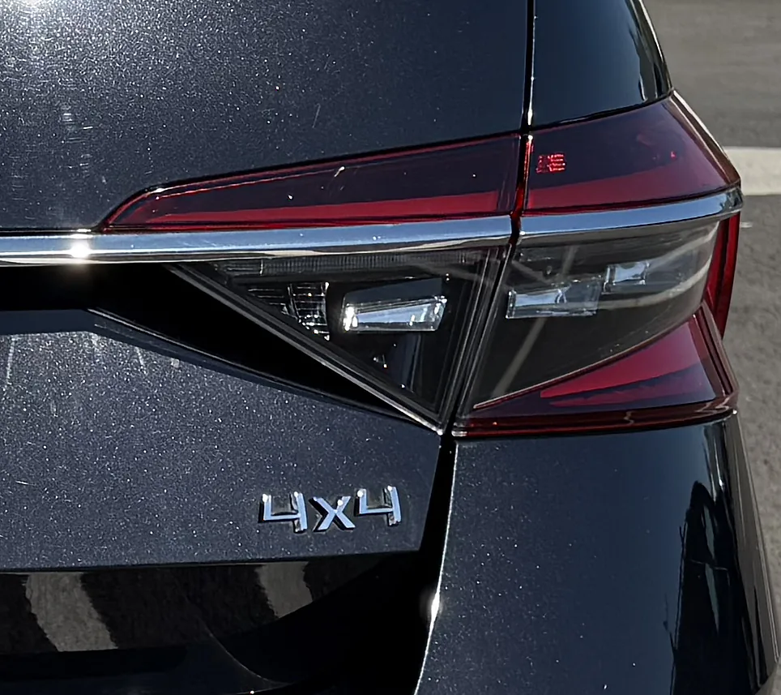
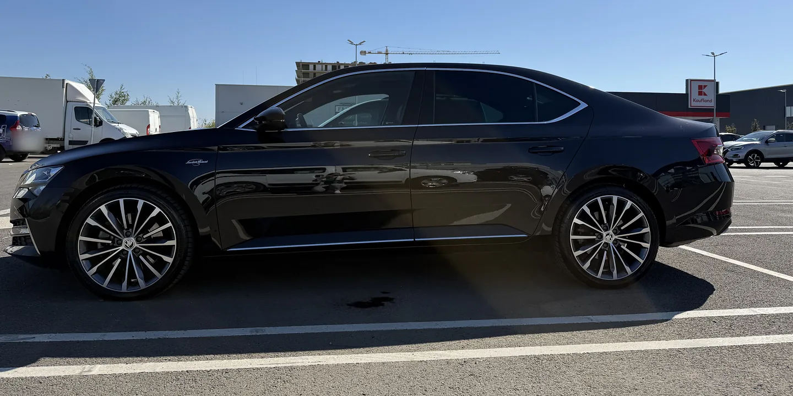

Am un Skoda Superb 2020 cu motorul 2.0 TSI de 272 CP și tracțiune integrală, pe care l-am condus aproape 40.000 km, inclusiv iarna, pe drumul prin Cheile Bicazului. Dacă te întrebi dacă merită să cauți un Superb 4x4 sau să plătești în plus pentru unul nou, aici găsești ce am simțit eu și ce spun datele Škoda și testele independente: cât consumă în plus, ce face iarna și ce nu face, cât costă întreținerea și cât te costă la cumpărare.

**Pe scurt**

- **Merită:** dacă mergi des la munte sau pe drumuri cu zăpadă, dacă tragi remorcă sau dacă vrei oricum motorul cel mai puternic.
- **Nu merită:** dacă mergi mai ales prin oraș și pe autostradă, la câmpie. Acolo un Superb pe față cu anvelope de iarnă bune îți ajunge.
- **Ce te costă:** cam 80 kg în plus, cam 0,5 l/100 km în plus la același motor și un schimb de ulei la cuplajul 4x4 la fiecare 3 ani.
- **Ce nu face:** nu te oprește mai repede pe zăpadă și nu înlocuiește anvelopele de iarnă.
- **Capcana:** la Superb, 4x4 vine doar cu motoarele de top. Nu alegi doar tracțiunea, alegi tot pachetul.

## Cum funcționează 4x4 la Superb

Superb nu are tracțiune integrală permanentă. În mers normal, aproape toată forța merge la roțile din față, iar mașina se poartă ca una cu tracțiune față. Între cardan și puntea spate se află un ambreiaj cu mai multe discuri în baie de ulei, cuplajul Haldex. Când roțile din față încep să patineze, o pompă electrică strânge discurile și trimite o parte din cuplu în spate, în câteva milisecunde.

Calculatorul nu așteaptă doar să patineze roțile. Se uită la turația fiecărei roți, la unghiul volanului, la cât apeși accelerația și la accelerațiile laterale și longitudinale, așa că poate cupla puntea spate înainte să simți tu ceva. Škoda spune că sistemul poate trimite până la 90 % din cuplu pe puntea spate atunci când roțile din față nu mai au aderență ([Škoda](https://cdn.skoda-storyboard.com/2023/01/Press_Kit_Skoda_Winter_Experience_0fc3897c.pdf)). E o limită, nu o distribuție fixă: Superb nu merge „50:50” tot timpul.

Superb 3 (2015–2023) folosește a cincea generație a acestui cuplaj. La asta se adaugă blocajul electronic de diferențial (EDS), care frânează roata care patinează, și XDS+, care frânează roata din interiorul virajului ca să nu fugă mașina de bot. Acestea două există și pe Superb-urile cu tracțiune față, așa că nici acelea nu sunt neajutorate pe drum alunecos.

Superb Scout, varianta Combi cu aspect de off-road, are în plus 15 mm de gardă la sol, protecții, mod Off-Road și asistent la coborâre ([Škoda](https://cdn.skoda-storyboard.com/2023/01/Press_Kit_Skoda_Winter_Experience_0fc3897c.pdf)). Un Superb 4x4 obișnuit nu are nimic din toate astea.

## Ce motoare au avut 4x4

| Perioadă | Benzină cu 4x4 | Diesel cu 4x4 |
| --- | --- | --- |
| Superb 3, 2015–2019 | 1.4 TSI 150 CP (manuală), 2.0 TSI 280 CP, apoi 272 CP (DSG) | 2.0 TDI 150 CP (manuală), 2.0 TDI 190 CP (DSG) |
| Superb 3 facelift, 2019–2023 | 2.0 TSI 272 CP, apoi 280 CP (DSG) | 2.0 TDI 190 CP, apoi 200 CP (DSG) |
| Superb 4, din 2024 | 2.0 TSI 265 CP (DSG) | 2.0 TDI 193 CP (DSG) |

Surse: [Škoda 2015](https://cdn.skoda-storyboard.com/2016/04/150915-SKODA-at-the-IAA-Press-Kit.pdf), [Škoda 2019](https://cdn.skoda-storyboard.com/2019/06/04_Press_Kit_SKODA_SUPERB_Engines.pdf), [Škoda 2023](https://cdn.skoda-storyboard.com/2016/05/TD-SUPERB-de-2.pdf), [lista de prețuri Škoda România pentru anul model 2026](https://constanta.aviamotors.ro/wp-content/uploads/2025/10/SUPERB_CW42_2025_MY26.pdf).

De aici vine capcana de care vorbeam: în afară de primii ani ai lui Superb 3, 4x4 a venit doar cu cele mai puternice motoare. La facelift, benzina de 272 CP n-a existat deloc cu tracțiune față. Așa că, în practică, alegerea e între un Superb puternic cu 4x4 și un Superb obișnuit pe față. Diferențele pe care le vezi la consum și la preț vin în mare parte din motor, nu din tracțiune.

## Cât consumă în plus

Ca să vezi cât costă 4x4 în sine, trebuie comparat același motor, cu aceeași cutie, cu și fără tracțiune integrală. Dieselul de 190/200 CP a existat în ambele variante, iar Škoda a publicat consumul pentru amândouă:

| Versiune (consum mixt WLTP) | Tracțiune față | 4x4 | Diferență |
| --- | --- | --- | --- |
| Liftback 2.0 TDI 190 CP DSG, 2019 | 5,2–6,4 l/100 km | 5,6–7,1 l/100 km | +0,4–0,7 |
| Liftback 2.0 TDI 200 CP DSG, 2023 | 5,3–5,7 l/100 km | 5,8–6,2 l/100 km | +0,5 |
| Combi 2.0 TDI 200 CP DSG, 2023 | 5,4–5,9 l/100 km | 5,9–6,3 l/100 km | +0,4–0,5 |

Surse: [Škoda 2019](https://cdn.skoda-storyboard.com/2019/06/04_Press_Kit_SKODA_SUPERB_Engines.pdf), [Škoda 2023](https://cdn.skoda-storyboard.com/2016/05/TD-SUPERB-de-2.pdf).

Diferența e de aproximativ jumătate de litru la 100 km. La 20.000 km pe an înseamnă cam 100 de litri de motorină în plus, adică un plin și jumătate.

La benzină nu există o comparație la fel de curată. În 2019, Superb 2.0 TSI de 190 CP cu tracțiune față avea 6,6–8,0 l/100 km, iar 2.0 TSI de 272 CP cu 4x4 avea 8,0–9,3 l/100 km ([Škoda](https://cdn.skoda-storyboard.com/2019/06/04_Press_Kit_SKODA_SUPERB_Engines.pdf)). Diferența de aproape un litru și jumătate vine mai ales din motorul mai puternic.

Mie îmi iese 9–10 l/100 km pe drum lung și 12–13 l/100 km în București, cu un stil de condus destul de sportiv. Iarna nu consumă vizibil mai mult. Pe forumul polonez autocentrum.pl, media raportată de proprietari este 9,9 l/100 km pentru 2.0 TSI de 280 CP și 6,8 l/100 km pentru 2.0 TDI de 190 CP ([autocentrum.pl](https://www.autocentrum.pl/publikacje/zakup-i-sprzedaz/skoda-superb-iii-2-0-tdi-190-km-vs-2-0-tsi-280-km-4x4-komfortowa-limuzyna-kontra-sleeper-koszty-utrzymania-napedu-haldex/)).

## Masă, remorcă, gardă la sol și portbagaj

Datele de mai jos sunt pentru Superb 3 facelift cu 2.0 TDI de 200 CP și cutie DSG, din fișa tehnică Škoda din februarie 2023 ([Škoda](https://cdn.skoda-storyboard.com/2016/05/TD-SUPERB-de-2.pdf)):

| | Liftback față | Liftback 4x4 | Combi față | Combi 4x4 |
| --- | --- | --- | --- | --- |
| Masă proprie cu șofer | 1.596–1.766 kg | 1.673–1.843 kg | 1.612–1.808 kg | 1.689–1.885 kg |
| Remorcă cu frână | 2.000 kg | 2.200 kg | 2.000 kg | 2.200 kg |
| Gardă la sol | 139 mm | 136 mm | 139 mm | 136 mm |
| Portbagaj | 625 l | 625 l | 660 l | 660 l |
| Rezervor | 66 l | 66 l | 66 l | 66 l |

Trei lucruri merită reținute:

- **Remorca:** cu 4x4 poți trage 200 kg în plus. Dacă ai rulotă sau remorcă de barcă, e un argument real.
- **Garda la sol:** 4x4 nu ridică mașina. E chiar cu 3 mm mai jos. Dacă vrei gardă mai mare, ai nevoie de Scout.
- **Portbagajul și rezervorul:** sunt identice. La Superb, 4x4 nu îți ia din spațiu.

În plus, același diesel accelerează cu 4x4 de la 0 la 100 km/h în 8,0 secunde în loc de 8,3, pentru că nu patinează la plecare ([manualul Superb 3](https://ownersmanuals.blob.core.windows.net/ownersmanuals/ro/Superb_3V/11-2018/OwnersManual.pdf)).

## Iarna: ce face 4x4 și ce nu face

**Unde ajută:** la plecarea de pe loc pe zăpadă sau pe ud, la urcare și la ieșirea din viraj când accelerezi. Roțile din față nu mai trebuie să tragă singure, așa că patinează mult mai puțin.

**Unde nu ajută:** la frânare. Orice mașină frânează deja cu toate cele patru roți, deci 4x4 nu scurtează distanța de oprire. Nici la intrarea în viraj nu ajută: acolo contează doar aderența anvelopelor și viteza cu care intri. Revista Auto Bild a scris în ianuarie 2026 că masa în plus a unei mașini 4x4 poate chiar să lungească frânarea pe drum alunecos ([Auto Bild](https://www.autobild.de/artikel/winter-mythos-allrad-28516855.html)).

Aici e și pericolul. Un 4x4 pleacă de pe loc atât de ușor pe zăpadă încât te poate face să crezi că are mai multă aderență decât are. Ușurința cu care pornești nu spune nimic despre cât de repede te poți opri.

### Anvelopele contează mai mult decât tracțiunea

Tyre Reviews a pus în Finlanda față în față două BMW X1: unul cu 4x4 și anvelope de vară, celălalt cu tracțiune față și anvelope de iarnă. Cel cu tracțiune față a frânat mai scurt și a urcat panta pe care 4x4-ul patina pe loc ([video Tyre Reviews](https://www.youtube.com/watch?v=atayHQYqA3g)). Concluzia revistei Auto Express după un test asemănător: cel mai bine e un 4x4 pe anvelope de iarnă, dar fără anvelopele potrivite un 4x4 e la fel de neajutorat ca o mașină cu tracțiune pe o singură punte ([Auto Express](https://www.autoexpress.co.uk/accessories-tyres/89355/winter-tyre-test-2013)).

Eu am iarna anvelope Hankook pe aceleași jante de 19". Sunt foarte bune, dar ceva mai zgomotoase decât cele de vară.

Și legea e aceeași pentru toți: în România, anvelopele de iarnă sunt obligatorii când drumul e acoperit de zăpadă, gheață sau polei, indiferent de lună și indiferent dacă mașina e 4x4 ([Codul rutier, OUG 195/2002](https://legislatie.just.ro/Public/DetaliiDocument/41006)). Manualul Škoda cere anvelope de iarnă pe toate cele patru roți, cu cel puțin 4 mm adâncime a profilului ([manualul Superb 3](https://ownersmanuals.blob.core.windows.net/ownersmanuals/ro/Superb_3V/11-2018/OwnersManual.pdf)).

### Lanțurile: doar în față și doar pe 16" sau 17"

Mulți presupun că pe un 4x4 lanțurile se pun în spate sau că merg pe orice roată. Manualul Superb 3 spune altceva: lanțurile se montează **numai pe roțile din față** și **numai pe 215/60 R16 sau 215/55 R17**, pe jante cu ET41 ([manualul Superb 3](https://ownersmanuals.blob.core.windows.net/ownersmanuals/ro/Superb_3V/11-2018/OwnersManual.pdf)). Pe 18" sau 19" nu ai voie.

Asta înseamnă că pe mașina mea, cu 235/40 R19, nu pot pune lanțuri deloc. Nu am avut niciodată nevoie de ele, dar dacă mergi des pe drumuri unde indicatorul le cere, ia în calcul un set de iarnă pe 17". Verifică înainte în manualul mașinii tale ce jante acceptă frânele motorului tău.

## Ce am simțit eu în 40.000 km

Când am cumpărat mașina locuiam în Cluj și treceam des prin Cheile Bicazului. În toți kilometrii ăștia, pe zăpadă sau pe gheață, n-am avut nicio situație în care mașina să alunece. Dar nu pun asta doar pe seama tracțiunii: am avut mereu anvelope premium, iar combinația dintre ele și 4x4 e ce m-a ținut pe drum.

Cel mai tare am simțit stabilitatea mașinii vara, nu iarna. Mergeam cu 150 km/h pe autostradă când mi-a sărit un câine în față. Am frânat puternic și am ocolit, iar mașina a rămas perfect stabilă. Eu am simțit că tracțiunea integrală a ajutat mult. Ca să fiu corect, la o frânare cu ocolire lucrează în primul rând ABS-ul, controlul stabilității (ESC) și anvelopele; 4x4 contează mai ales când accelerezi din nou ca să ieși din manevră. Oricum ar fi împărțit meritul, pachetul a funcționat exact când trebuia.

Nu am condus un Superb cu tracțiune față iarna, așa că nu pot face o comparație directă. Nici remorcă n-am tras.

## Cât costă întreținerea 4x4

Tracțiunea integrală are trei componente cu ulei separat de cel al motorului și al cutiei:

| Ce | Când | Cât am plătit eu sau cât am găsit |
| --- | --- | --- |
| Uleiul cuplajului Haldex | la 3 ani, după planul Škoda ([Škoda](https://www.skoda-auto.com/_doc/eb5dd7a6-8c4c-4376-a719-799ed4f87427)) | eu: 3.000 MDL (~150 €); în România: 799 lei un pachet cu manoperă la un service de cutii automate ([MGV](https://mgvautomaticgearbox.ro/produse/schimb-ulei-haldex-gen-5-vw/)), 350 lei doar uleiul original de 850 ml ([Ulei de Ulei](https://www.uleideulei.ro/ulei-transmisii-turisme-c-105/ulei-cuplaj-haldex-original-vw-audi-g060175a2-850-ml.html)) |
| Uleiul reductorului unghiular (lângă cutie) | fără interval în planul Škoda | eu: 1.100 MDL (~55 €) cu manoperă |
| Uleiul diferențialului spate | fără interval în planul Škoda | nu l-am schimbat încă |

Sumele în MDL sunt la cursul de circa 20 MDL pentru 1 €. Detaliile despre uleiuri, coduri și ce am făcut la cutia DSG sunt în [recenzia Superb-ului meu](/recenzii/skoda-superb-2020-pareri-proprietar/).

Sfatul meu: nu sări peste uleiul de la Haldex, chiar dacă cineva din service îți spune că nu e nevoie. E în planul de întreținere Škoda, iar cuplajul are o sită la pompă care se poate înfunda. Un service din Irlanda a găsit sita „destul de înfundată” la un Skoda Kodiaq 4x4 după doar 20.000 de mile, cam 32.000 km ([autobiz.ie](https://autobiz.ie/home/koda-kodiaq---haldex-mesh-filter)). Când sita se înfundă, pompa nu mai primește ulei, iar puntea spate nu mai e cuplată. Mașina merge mai departe, dar ca una cu tracțiune față. Când faci schimbul, cere să se curețe și sita.

Pentru impozit nu contează: din 2026, impozitul auto se calculează după capacitatea cilindrică și norma de poluare, nu după tracțiune ([Codul fiscal, art. 470](https://legislatie.just.ro/Public/DetaliiDocumentAfis/305296)). Nu am găsit nicio dovadă că asigurătorii cer mai mult la RCA doar pentru 4x4.

## Probleme cunoscute

Am căutat pe forumurile proprietarilor de Skoda din Marea Britanie și din România. Nu există un defect tipic al sistemului 4x4 la Superb 3, doar cazuri izolate:

- **Pompa Haldex:** cedează mai ales când sita e înfundată. Un proprietar de Superb 3 avea zgomot în spate la virajele strânse, fără nicio eroare; după schimbarea pompei a dispărut ([Briskoda](https://www.briskoda.net/forums/topic/526836-noise-in-rear-wheels-when-turning-haldex/)).
- **Cardanul:** unui alt proprietar i s-a semnalat la revizie un posibil defect la cuplajul elastic al cardanului, neconfirmat până la urmă ([Briskoda](https://www.briskoda.net/forums/topic/515400-rear-propshaft-coupling/)).
- **Reductorul unghiular:** există relatări despre scurgeri de ulei, dar cele găsite sunt de la Superb 2, nu de la Superb 3 ([Briskoda](https://www.briskoda.net/forums/topic/527230-bevel-gearbox-leak/)).

Problemele mai cunoscute la versiunile 4x4 sunt de fapt la cutia DSG cu 7 trepte și la pompa de apă, nu la tracțiune. Le-am descris în [recenzie](/recenzii/skoda-superb-2020-pareri-proprietar/).

## Cât plătești în plus

### Nou: Superb 4

În lista de prețuri Škoda România pentru anul model 2026 (octombrie 2025), cu TVA ([lista Škoda România](https://constanta.aviamotors.ro/wp-content/uploads/2025/10/SUPERB_CW42_2025_MY26.pdf)):

| Echipare | Tracțiune față | 4x4 | Diferență |
| --- | --- | --- | --- |
| Selection, diesel | 2.0 TDI 150 CP: 41.876 € | 2.0 TDI 193 CP: 45.014 € | +3.138 € |
| Selection, benzină | 2.0 TSI 204 CP: 41.156 € | 2.0 TSI 265 CP: 45.065 € | +3.909 € |
| Sportline, benzină | 2.0 TSI 204 CP: 46.793 € | 2.0 TSI 265 CP: 50.703 € | +3.910 € |
| L&K, benzină | 2.0 TSI 204 CP: 47.646 € | 2.0 TSI 265 CP: 51.556 € | +3.910 € |

Echiparea de bază, Essence, nu se vinde cu 4x4. În diferențele de mai sus intră și motorul mai puternic, nu doar tracțiunea.

### Second hand: Superb 3

Pe Autovit, pe 12 noiembrie 2026, erau listate 50 de Superb diesel cu 4x4 și 244 cu tracțiune față. Adică un Superb diesel din șase e 4x4, deci ai mai puțin de unde alege. Aproape toate cele 4x4 sunt de 190 sau 200 CP, iar cele pe față sunt mai ales de 150 CP.

Am căutat perechi cât mai asemănătoare, iar rezultatul n-a fost constant. Un Superb Combi Style 2.0 TDI 190 DSG din 2019–2020, cu peste 200.000 km, era cerut cu 2.000 € mai mult în varianta 4x4 ([anunț 4x4](https://www.autovit.ro/autoturisme/anunt/skoda-superb-ver-2-0-tdi-4x4-dsg-style-ID7HQFBk.html), [anunț fără 4x4 în titlu](https://www.autovit.ro/autoturisme/anunt/skoda-superb-ver-2-0-tdi-dsg-style-ID7HQLoQ.html)). La alte perechi de 200 CP, varianta 4x4 era mai ieftină, dar avea mai mulți kilometri. Pe scurt, la mâna a doua nu plătești o primă fixă pentru 4x4. Contează mai mult kilometrii și starea.

### Ce verifici la un Superb 4x4 second hand

Pe lângă [lista din recenzie](/recenzii/skoda-superb-2020-pareri-proprietar/):

- **Facturile:** caută schimbul de ulei la Haldex, la 3 ani. Întreabă dacă s-a curățat și sita pompei.
- **Diagnoza:** cere să fie citit și modulul de tracțiune integrală, nu doar motorul. Păstrează raportul înainte să se șteargă erorile.
- **Plecarea pe ud sau pe pietriș:** accelerează puternic cu volanul drept. Un 4x4 care merge nu patinează ca o mașină cu tracțiune față.
- **Virajele strânse:** la viteză mică, cu volanul bracat la maximum, în ambele sensuri. Nu trebuie să apară smucituri sau zgomote din spate.
- **Scurgerile:** pe elevator, uită-te la reductorul de lângă cutie și la diferențialul spate.
- **Anvelopele:** toate patru de aceeași marcă, același model, aceeași dimensiune și cu uzură apropiată. Manualul cere același tip și aceeași dimensiune pe toate roțile.

## Verdict: merită?

Pentru mine, da. Aș cumpăra din nou exact aceeași mașină. Dar trebuie spus de ce: 4x4 la Superb vine la pachet cu motorul de 272 CP, iar fără tracțiune integrală puterea asta ar fi greu de folosit pe asfalt ud. Dacă vrei un Superb rapid, 4x4 nu e o opțiune, e o necesitate.

**Ia 4x4 dacă:** mergi des la munte iarna, ai de urcat rampe pe zăpadă, tragi remorcă sau vrei motorul cel mai puternic.

**Nu-l lua dacă:** mergi mai ales prin oraș și pe autostradă și vrei consum mic. Un Superb 2.0 TDI de 150 CP cu tracțiune față și anvelope de iarnă bune face aproape tot ce face unul 4x4, cu câteva mii de euro mai puțin.

**Oricum ar fi:** banii pentru anvelope de iarnă bune contează mai mult decât tracțiunea. Un 4x4 pe anvelope de vară e mai periculos iarna decât un Superb cu tracțiune față pe anvelope de iarnă.

## Întrebări frecvente

**Skoda Superb 4x4 are tracțiune integrală permanentă?** Nu. În mers normal, cea mai mare parte a cuplului merge la roțile din față. Cuplajul Haldex trimite cuplu și în spate când roțile din față încep să patineze sau când calculatorul anticipează că vor patina. Škoda spune că poate trimite până la 90 % din cuplu pe puntea spate.

**Cât consumă în plus un Superb 4x4?** La același motor și aceeași cutie, cam 0,5 l/100 km în plus după datele oficiale WLTP. De exemplu, Superb liftback 2.0 TDI de 200 CP DSG are 5,3–5,7 l/100 km cu tracțiune față și 5,8–6,2 l/100 km cu 4x4.

**Superb 4x4 frânează mai bine pe zăpadă?** Nu. Orice mașină frânează cu toate cele patru roți, iar 4x4 nu scurtează distanța de oprire. Pe zăpadă contează anvelopele. Tracțiunea integrală ajută la plecare, la urcare și la ieșirea din viraj.

**Unde se pun lanțurile pe un Skoda Superb 4x4?** Numai pe roțile din față, ca la cele cu tracțiune față. Manualul Superb 3 le permite doar pe anvelope 215/60 R16 sau 215/55 R17. Pe jante de 18" sau 19" nu ai voie să montezi lanțuri.

**Cât de des se schimbă uleiul la Haldex?** La fiecare 3 ani, după planul de întreținere Škoda, indiferent de kilometraj. Cere să se curețe și sita pompei, pentru că dacă se înfundă, pompa se poate strica.

**Ce motoare are Superb 4x4?** La Superb 3 facelift (2019–2023): 2.0 TSI de 272 sau 280 CP și 2.0 TDI de 190 sau 200 CP, toate cu DSG. La Superb 4 (din 2024): 2.0 TSI de 265 CP și 2.0 TDI de 193 CP.

**Cât costă în plus un Superb 4 nou cu 4x4?** În lista Škoda România pentru anul model 2026, trecerea de la 2.0 TDI 150 CP cu tracțiune față la 2.0 TDI 193 CP 4x4 costă 3.138 € cu TVA la echiparea Selection. Diferența include și motorul mai puternic.

**Superb 4x4 are garda la sol mai mare?** Nu. Superb 3 facelift diesel are 139 mm cu tracțiune față și 136 mm cu 4x4. Doar Superb Scout are 15 mm în plus.
