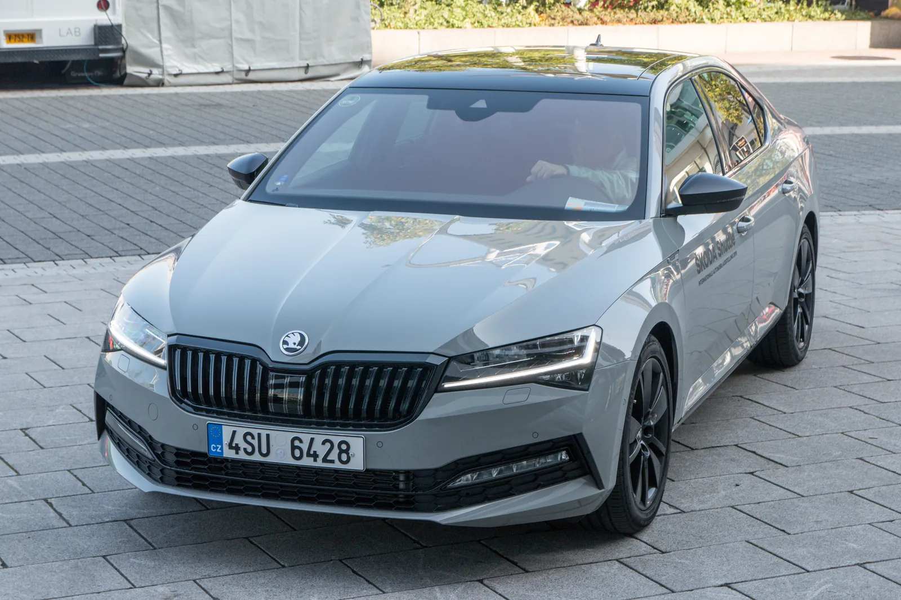
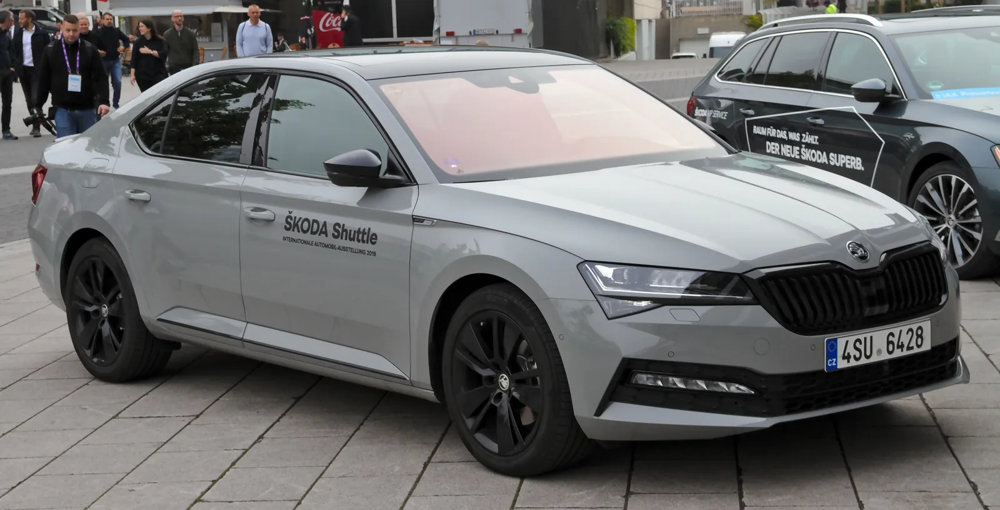
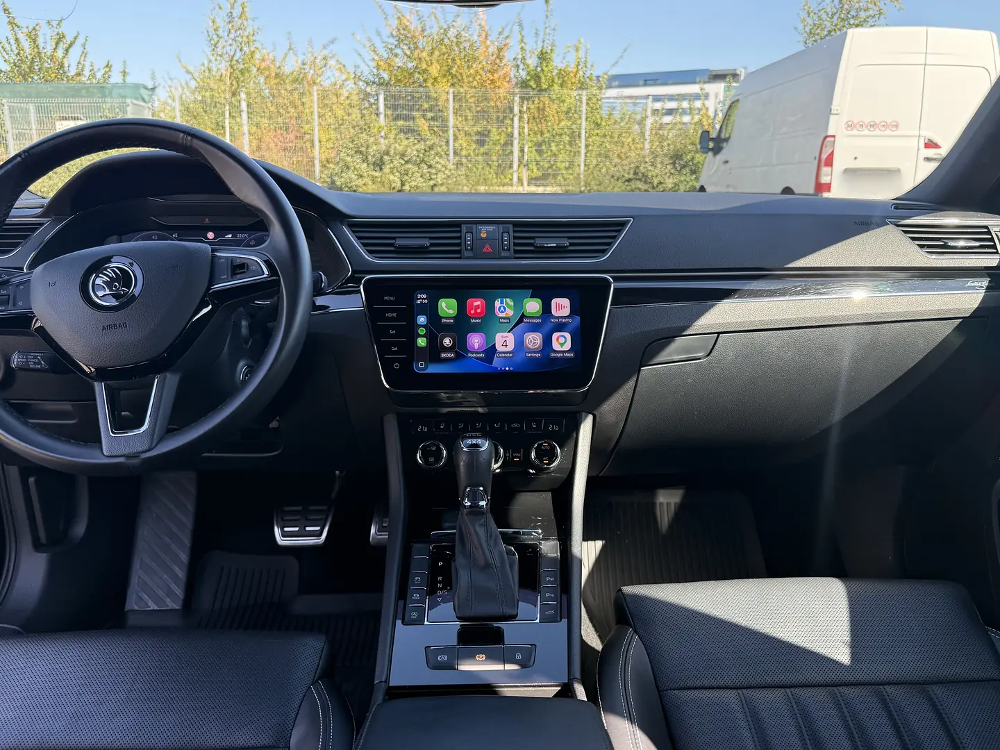
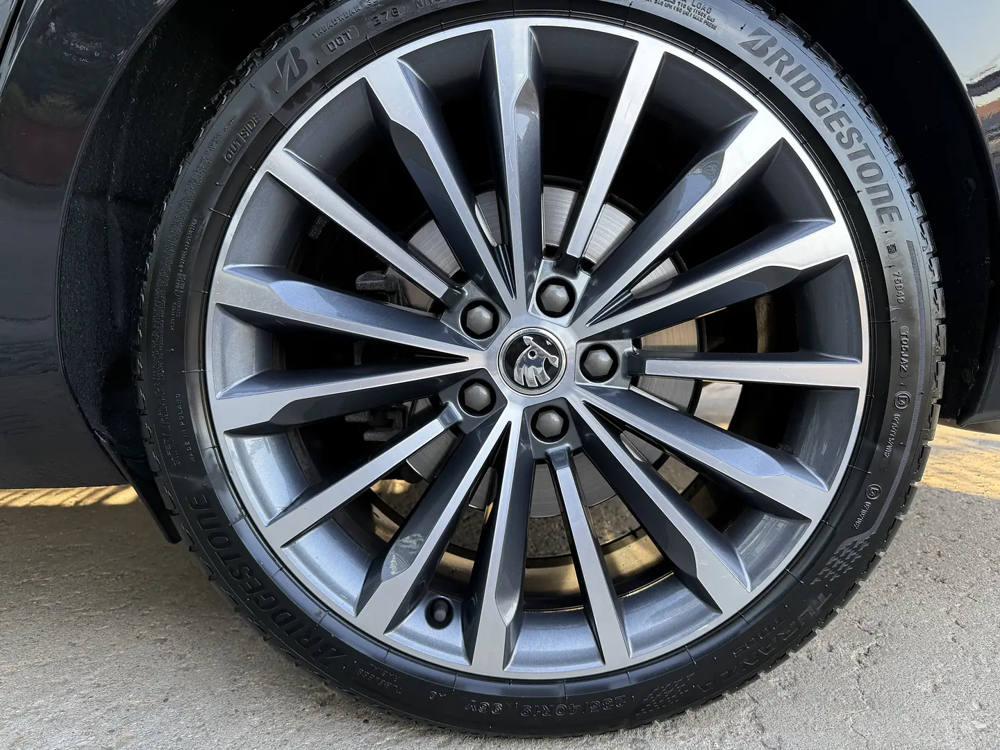
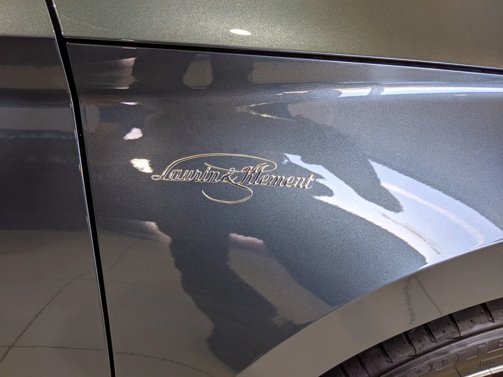
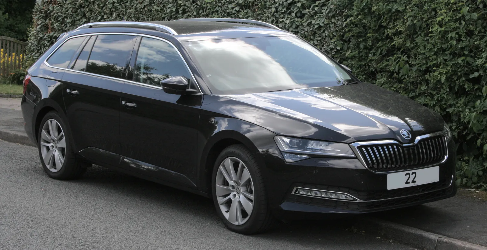
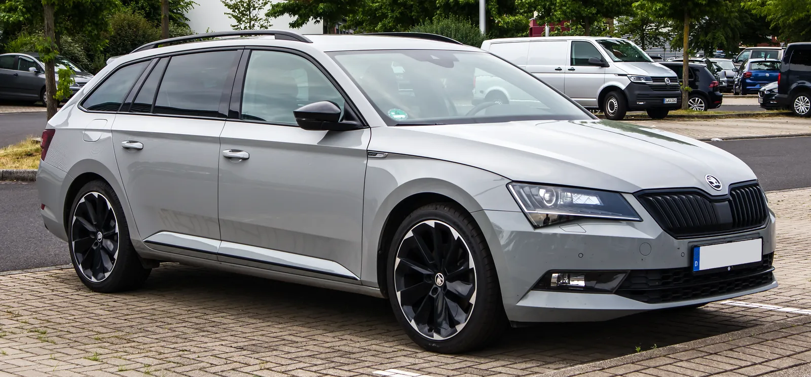

Dacă te uiți după un Skoda Superb second hand, în anunțurile cu mașini bine echipate dai mereu de trei nume: Style, Sportline și Laurin & Klement. Eu am un Superb Laurin & Klement din 2020 pe care l-am condus aproape 40.000 km, așa că partea despre L&K e din experiență. Pentru Sportline și Style m-am uitat în listele oficiale de prețuri și dotări Škoda și am citit ce spun proprietarii.

Concluzia scurtă: L&K e pentru confort, Sportline pentru aspect și un scaun sport, iar Style pentru cel mai mult Superb pe euro. La mâna a doua însă, numele echipării spune mai puțin decât crezi. Contează ce opțiuni are mașina concretă și pentru ce țară a fost fabricată.

**Pe scurt**

- **Alege L&K dacă:** vrei confort pe drum lung; suspensia adaptivă DCC și sistemul audio Canton sunt de obicei standard, iar scaunele ventilate sunt posibile, dar nu garantate.
- **Alege Sportline dacă:** îți place aspectul cu detalii negre și un scaun sport care te ține bine; nu poate avea scaune ventilate, iar DCC depinde de țara pentru care a fost făcută mașina.
- **Alege Style dacă:** vrei cel mai bun raport preț/dotări; găsești cele mai multe anunțuri, iar ca opțiuni putea avea aproape tot ce avea un L&K.
- **Atenție:** nici L&K nu înseamnă „full”; pilotul automat adaptiv, camerele, asistențele, ventilația și trapa erau opțiuni și la L&K.

## Despre ce Superb vorbim

Ghidul e despre Superb 3 facelift, prezentat pe 23 mai 2019 și vândut până în 2023. Asta e și generația mașinii mele. Diferențele față de Superb 3 dinainte de facelift (2015–2019) sunt la final, iar Superb 4 (din 2024) are altă listă de dotări.

Multe Superb-uri second hand din România sunt importate, iar dotările lor sunt cele din țara de origine. Fiecare importator decidea ce e standard, așa că același „Sportline” poate avea suspensie adaptivă în Germania și să nu o aibă în Irlanda. Contează și anul: Škoda a mutat dotări dintre standard și opțiuni aproape în fiecare an.

Ca referință am folosit listele oficiale Škoda din Germania pentru 2020, 2021 și 2022, pentru că arată clar ce era standard, ce era opțiune și ce nu se putea comanda deloc. Le-am comparat cu ghidul oficial Škoda din Irlanda (noiembrie 2022) și cu prețurile pe care le-am găsit pentru România.

*Foto: Johannes Maximilian, [Wikimedia Commons](https://commons.wikimedia.org/wiki/File:%C5%A0koda_Superb_III_IAA_2019_JM_0343.jpg), licență [CC BY-SA 4.0](https://creativecommons.org/licenses/by-sa/4.0/deed.ro). Fotografie redimensionată.*

## Ce era standard la fiecare echipare

Tabelul de mai jos e făcut după lista Škoda Germania pentru 2021, Superb liftback ([Style și L&K](https://www.skoda-media.de/model_optional/genpdf/103/6/225), [Sportline](https://www.skoda-media.de/model_optional/genpdf/103/84/225)). „Standard” înseamnă inclus în preț, o sumă înseamnă opțiune cu acel preț, iar „nu” înseamnă că dotarea nu se putea comanda.

| Dotare | Style | Sportline | L&K |
| --- | --- | --- | --- |
| Preț nou, 2.0 TSI 280 CP 4x4 DSG | 46.800 € | 50.280 € | 50.270 € |
| Jante standard | 17" | 19" | 18" |
| Faruri Full LED Matrix | standard | standard | standard |
| Tapițerie | textil (piele: 1.580 €) | Alcantara, scaune sport | piele |
| Tetiere față | reglabile | integrate în scaun | reglabile |
| Scaune electrice cu memorie | da, memorie doar la șofer | standard | standard, ambele scaune |
| Scaune față ventilate | 490 €, doar cu piele | nu | 490 € |
| Masaj la scaunul șoferului | 190 €, doar cu ventilație | nu | 190 €, doar cu ventilație |
| Suspensie adaptivă DCC | 1.050 € | standard | standard |
| Sistem audio Canton | 590 € | 590 € | standard |
| Intrare fără cheie (KESSY) | 290 € | standard | standard |
| Geamuri spate fumurii | 270 € | standard | standard |
| Senzori de parcare față | 340 € | 340 € | standard |
| Iluminare ambientală | 260 € | standard | standard |
| Pilot automat adaptiv (ACC) | 820 € | 820 € | 820 € |
| Lane Assist și Side Assist | 1.250 € | 1.250 € | 1.250 € |
| Cameră spate | 400 € | 400 € | 400 € |
| Bord digital Virtual Cockpit | 390 € | 390 € | 390 € |
| Trapă panoramică | 1.240 € | 1.240 € | 1.240 € |

Toate trei aveau standard hayon electric, scaune față încălzite și faruri Matrix. Încălzirea pe bancheta din spate, volanul încălzit (standard doar la Sportline), climatizarea cu trei zone și direcția progresivă erau opțiuni.

Ce diferă în alte țări:

- **Irlanda, 2022:** aici Sportline nu avea DCC nici ca opțiune, dar avea standard trapa panoramică. Style avea faruri LED simple, nu Matrix, iar L&K venea standard pe jante de 19" ([ghidul Škoda Irlanda](https://www.skoda.ie/_doc/ece2bdb0-073c-4238-93af-8e3d04847a1d)).
- **Germania, 2022:** bordul digital devine standard la toate, iar pilotul automat adaptiv, asistențele, camerele și climatizarea cu trei zone trec în pachete de opțiuni.
- **România:** nu am găsit lista originală a importatorului. O copie a listei din 2022, pe 2.0 TDI 200 CP, arată DCC și Canton standard la L&K și ventilația ca opțiune. Ce avea standard Sportline-ul românesc trebuie verificat pe mașină.

## Sportline: arată cel mai bine, dar verifică suspensia și scaunele

Sportline se recunoaște ușor: ramă neagră lucioasă la grilă, oglinzi negre, bandă neagră între stopuri, bara față cu textură de fagure și ecusoane Sportline pe aripi. În interior are plafon negru, ornamente cu aspect de carbon, volan sport cu trei spițe, pedale din inox și scaune sport din Alcantara și piele ([kitul de presă Škoda, mai 2019](https://cdn.skoda-storyboard.com/2019/05/07_Press_Kit_SKODA_iV_SUPERB_SPORTLINE.pdf)).

Motoarele sunt aceleași ca la celelalte echipări. Un Sportline nu are mai mulți cai putere decât un Style sau un L&K cu același motor.

*Foto: Alexander Migl, [Wikimedia Commons](https://commons.wikimedia.org/wiki/File:%C5%A0koda_Superb_III_at_IAA_2019_IMG_0397.jpg), licență [CC BY-SA 4.0](https://creativecommons.org/licenses/by-sa/4.0/deed.ro). Fotografie redimensionată.*

**Suspensia:** în Germania, Sportline-ul facelift avea standard suspensia adaptivă DCC, coborâtă cu 10 mm, în fiecare an. În Irlanda nu o avea deloc. Modul Sport din meniu nu dovedește nimic, pentru că selectarea profilului de condus există și fără DCC.

**Scaunele:** au tetiera integrată în spătar, deci nu o poți regla pe înălțime, și laterale mai înalte decât scaunele de la Style și L&K. Unora li se potrivesc perfect, altora nu. Într-o discuție pe Reddit, un participant de 1,75 m le preferă și pe drum lung ([Reddit](https://www.reddit.com/r/skoda/comments/1w1g279/superb_mk3_sportline_vs_lk/)), iar în alta autorul și încă un participant se plâng că nu găsesc o poziție bună ([Reddit](https://www.reddit.com/r/skoda/comments/1eoqm5n/superb_mk3_sportline_uncomfortable_seats/)). Fă o probă de cel puțin o oră înainte să cumperi.

**Ventilația:** în listele Škoda din Germania și Irlanda, scaunele Sportline nu aveau ventilație nici ca opțiune. Dacă vara stai mult în mașină, asta e cea mai mare diferență față de L&K.

**Jantele:** în Germania, Sportline venea standard pe 19", iar în kitul de presă internațional pe 18" negre. Pe 19" anvelopele sunt 235/40 R19, scumpe și sensibile la gropi; am scris despre asta în [recenzia Superb-ului meu](/recenzii/skoda-superb-2020-pareri-proprietar/).

**Prețul:** în Germania, Sportline costa practic cât L&K. În România era mai aproape de Style (vezi mai jos).

## Laurin & Klement: ce am eu după aproape 40.000 km

L&K e echiparea de top. Se recunoaște după inscripția Laurin & Klement de pe aripile din față, de pe ornamentul bordului din dreptul pasagerului și de pe spătarele scaunelor din față, plus mai mult crom la prizele de aer, la praguri și la bara spate. Are piele, scaune electrice cu memorie pe ambele locuri din față, iar în toate listele pe care le-am văzut, DCC și Canton sunt standard.

Mașina mea are DCC, Canton, scaune față încălzite și ventilate, pilot automat adaptiv, asistentul care parchează singur, Virtual Cockpit și jante de 19". Nu are trapă. O parte din lista asta nu vine de la L&K, ci de la primul proprietar, care a bifat opțiunile. Un alt L&K din 2020 poate să nu aibă ventilație, cameră sau pilot automat adaptiv.

**Scaunele ventilate:** sunt dotarea pe care o apreciez cel mai mult. Am condus un Mercedes GLS 400d și un BMW Seria 7 din 2023, iar mie ventilația din Superb mi s-a părut mai eficientă. E o impresie personală, nu un test, dar vara face diferența.

**Scaunele în general:** le găsesc foarte confortabile. Nu e de la sine înțeles: într-un BMW X7 M50d n-am reușit să găsesc o poziție firească.

**Suspensia:** îmi place cum lucrează DCC. Ce o limitează sunt jantele de 19". Fără ele, cred că mașina s-ar simți ca un nor.

Un detaliu util: în Germania, L&K venea standard pe jante de 18" (Propus Aero), iar cele de 19" erau opțiune. Dacă vrei un L&K pentru confort, caută unul pe 18" sau pune măcar iarna jante de 18". DCC te ajută să alegi cât de fermă e suspensia, dar nu compensează anvelopele cu profil jos.

*Foto: Vauxford, [Wikimedia Commons](https://commons.wikimedia.org/wiki/File:Laurin_%26_Klement_Badge.jpg), licență [CC BY-SA 4.0](https://creativecommons.org/licenses/by-sa/4.0/deed.ro). Fotografie redimensionată.*

Ce nu era inclus la L&K, cel puțin în Germania: pilotul automat adaptiv, Lane Assist și Side Assist, camera spate, ventilația, încălzirea pe bancheta din spate, volanul încălzit, trapa și, până în 2022, bordul digital. Toate se plăteau separat, exact ca la Style.

## Style: cel mai mult Superb pe euro

Style era echiparea de mijloc și e cea pe care o găsești cel mai des la vânzare. În Germania avea standard faruri Matrix, hayon electric, scaune față încălzite, scaun șofer electric cu memorie și jante de 17". Tapițeria standard era din textil, iar pielea era opțiune. În Irlanda, Style avea piele, dar faruri LED simple.

*Foto: DieselFordMondeo, [Wikimedia Commons](https://commons.wikimedia.org/wiki/File:2022_%C5%A0koda_Superb_SE_L_2.0_TDI_(Front).jpg), licență [CC BY-SA 4.0](https://creativecommons.org/licenses/by-sa/4.0/deed.ro). Fotografie redimensionată. În Marea Britanie, echiparea apropiată de Style se numea SE L.*

Partea interesantă e lista de opțiuni: DCC, Canton, piele, scaune ventilate, masaj, pilot automat adaptiv, camerele și trapa se puteau comanda toate la Style. Un Style bine echipat poate avea aproape tot ce are un L&K, mai puțin inscripțiile, ornamentul negru lucios și plafonul din Alcantara.

Dacă te interesează farurile Matrix, uită-te în far după inscripția „ŠKODA Crystal Lighting”: Škoda o pune doar pe farurile Matrix.

## Ce spun alți proprietari

Am citit discuții de pe forumuri din România și din Marea Britanie. Sunt experiențe individuale, nu statistici.

- **DCC face diferența, dar nu pentru toată lumea:** pe [Briskoda](https://www.briskoda.net/forums/topic/478829-sport-line-plus-better-car-than-laurin-klement/), un proprietar care a trecut de la Sportline la L&K spune că mașina e mult mai rafinată și pune asta mai ales pe seama DCC. Alții din aceeași discuție preferă aspectul Sportline. Pe [Reddit](https://www.reddit.com/r/skoda/comments/1dinrlq/prospective_superb_buyer/), un proprietar de L&K 2019 cu jante de 19" spune că modul Normal e suficient de confortabil, iar Comfort poate fi prea moale.
- **Ventilația contează pe drum lung:** un proprietar român de L&K din 2016 o pune, alături de DCC, printre dotările pe care le-ar vrea din nou după un drum până în Grecia ([vwForum](https://vwforum.ro/topic/139490-skoda-superb-lk-20-tsi-220cp/)).
- **Canton e mai bun, dar nu spectaculos:** un proprietar de L&K facelift îl consideră un pas înainte față de sistemul standard, dar nu ar plăti separat pentru el ([Briskoda](https://www.briskoda.net/forums/topic/531840-help-understanding-the-mk35-facelift/)).
- **DCC poate costa la reparații:** proprietarii discută costul amortizoarelor adaptive ([Briskoda](https://www.briskoda.net/forums/topic/516079-skoda-superb-dcc-missing-or-not/)). La un L&K sau Sportline cu mulți kilometri, verifică-le la inspecție.

## Cât costau noi și cât costă acum

Prețurile de listă, cu TVA, pentru același motor:

| Piață și motor | Style | Sportline | L&K |
| --- | --- | --- | --- |
| Germania 2020, 2.0 TSI 272 CP 4x4 | 45.750 € | 49.190 € | 49.150 € |
| Germania 2021, 2.0 TSI 280 CP 4x4 | 46.800 € | 50.280 € | 50.270 € |
| România, 2.0 TSI 272 CP 4x4 | 38.494 € | 39.478 € | 41.542 € |
| Irlanda 2022, 2.0 TDI 150 CP DSG | 48.170 € | 50.395 € | 52.690 € |

Surse: [Škoda Germania 2020](https://www.skoda-media.de/model_optional/genpdf/103/6/205) și [Sportline 2020](https://www.skoda-media.de/model_optional/genpdf/103/84/205), [Škoda Germania 2021](https://www.skoda-media.de/model_optional/genpdf/103/6/225), [catalogul AutoMarket](https://www.automarket.ro/masini-noi/skoda/superb-facelift-5579/), [Škoda Irlanda](https://www.skoda.ie/_doc/ece2bdb0-073c-4238-93af-8e3d04847a1d). Prețurile din țări diferite nu se compară între ele, pentru că taxele și dotările standard diferă.

În Germania, L&K și Sportline costau aproape la fel, cu aproximativ 3.400–3.500 € peste Style. În România, Sportline era cu circa 1.000 € peste Style, iar L&K cu circa 3.000 €.

Când era nouă, echiparea L&K era o afacere. În lista germană din 2021, dacă luai un Style și adăugai ce avea L&K în plus (DCC, piele, Canton, KESSY, geamuri fumurii, iluminare ambientală, senzori față, profiluri de condus și jante de 18"), plăteai aproximativ 5.200 € în opțiuni, față de 3.470 € diferență de preț.

La mâna a doua, socoteala asta nu mai contează. Opțiunile nu își păstrează valoarea. În octombrie 2026, o căutare pe [autovit.ro](https://www.autovit.ro/autoturisme/skoda/superb/) după cuvânt cheie dădea 76 de anunțuri Superb cu „Style”, 21 cu „Sportline” și 19 cu „Laurin Klement”. Printre ele, kilometrajul, anul și tracțiunea mutau prețul mult mai mult decât echiparea: un Style din 2021 cu 63.000 km era mai scump decât un L&K din 2020 cu 140.000 km. Pe un eșantion atât de mic nu se poate calcula cât valorează în plus un L&K sau un Sportline.

Așa compar eu două mașini concrete: diferența de preț cerut plus cheltuielile imediate (anvelope, revizii restante, ce găsește mecanicul la inspecție). Apoi mă întreb ce dotări în plus o să folosesc de fapt.

## Cum verifici ce are de fapt mașina

1. **Află anul și țara de origine:** din talon, din cartea de service și din actele de import. De ele depinde ce era standard.
2. **Cere lista de dotări după serie de șasiu:** un service autorizat Škoda poate scoate lista echipamentelor montate din fabrică. E singura confirmare sigură.
3. **Verifică DCC:** în Drive Mode Select, alege Individual. Cu DCC, ai o setare separată pentru șasiu (Comfort, Normal, Sport). La drum, ascultă dacă bate ceva în suspensie pe drum prost.
4. **Verifică ventilația:** caută butoanele de ventilație lângă cele de încălzire și pielea perforată. Pornește-o pe fiecare treaptă și ascultă ventilatoarele.
5. **Verifică Canton:** sigla Canton apare pe grilele difuzoarelor din uși.
6. **Verifică farurile:** inscripția „ŠKODA Crystal Lighting” înseamnă faruri Matrix.
7. **Nu te baza pe ecusoane:** se pot cumpăra separat. La L&K, inscripția apare și pe bord, și pe spătare. La Sportline, scaunele cu tetieră integrată și plafonul negru se schimbă greu.
8. **Uită-te la jante și anvelope:** pe 19", caută tăieturi și umflături pe flancuri și verifică dacă cele patru anvelope sunt la fel, mai ales la 4x4.
9. **CarPlay wireless:** în lista germană apare standard din 2021. Pe Superb-urile din anul-model 2020, ca al meu, CarPlay merge doar prin cablu, indiferent de echipare.

## Verdict

**L&K** merită dacă stai mult în mașină și găsești un exemplar cu ventilație și cu DCC în stare bună. Pentru mine, scaunele ventilate și suspensia sunt cele mai importante dotări ale L&K-ului. Caută-l pe 18" dacă vrei confort maxim.

**Sportline** merită dacă îți place cum arată și îți vin bine scaunele sport. Verifică pe mașină dacă are DCC și acceptă că nu vei avea ventilație.

**Style** merită dacă vrei banii cei mai bine cheltuiți. Alege exemplarul după opțiunile pe care le are, nu după nume. Un Style cu DCC, piele și pilot automat adaptiv poate fi o alegere mai bună decât un L&K de bază.

Despre cum se comportă Superb-ul meu L&K în viața de zi cu zi, cât consumă și ce s-a stricat am scris în [recenzia după 40.000 km](/recenzii/skoda-superb-2020-pareri-proprietar/).

## Superb 3 dinainte de facelift și Superb 4

**Înainte de facelift (2015–2019):** nu există faruri Matrix, ele au apărut odată cu facelift-ul. Sportline a fost lansat în 2016. În Cehia venea cu jante de 18" și suspensie sport coborâtă cu 15 mm ([Škoda](https://www.skoda-storyboard.com/cs/tiskove-zpravy-archiv/nezamenitelny-vzhled-nova-skoda-superb-sportline-prijizdi/)), iar în Germania cu DCC și jante de 19" standard ([Škoda Germania](https://www.skoda-media.de/press/detail/2226/)). Se recunoaște după grila mai mică și farurile care nu ajung până la ea.

*Foto: M 93, [Wikimedia Commons](https://commons.wikimedia.org/wiki/File:Skoda_Superb_Combi_2.0_TDI_4x4_Sportline_(III)_%E2%80%93_f_06062021.jpg), licență [CC BY-SA 3.0 DE](https://creativecommons.org/licenses/by-sa/3.0/de/deed.ro). Fotografie redimensionată.*

**Superb 4 (din 2024):** aici lucrurile s-au schimbat. L&K are standard scaune încălzite, ventilate și cu masaj ([Škoda](https://www.skoda-storyboard.com/sk/press_kit/tlacova-mapa-nova-skoda-superb/superb-lk-vrcholny-model-s-exkluzivnymi-funkciami-a-jedinecnymi-dizajnovymi-prvkami/)), iar scaunele sport Sportline pot avea masaj și, într-o variantă, ventilație ([Škoda](https://www.skoda-storyboard.com/en/press-kits/the-all-skoda-superb-press-kit-2/superb-sportline-elegant-and-sporty-with-two-body-variants-and-typical-black-exterior-accents/)). Nimic din asta nu se aplică Superb 3.

## Întrebări frecvente

**Sportline are suspensie adaptivă DCC?** Depinde de țară. În Germania, Superb Sportline facelift avea DCC standard în 2020–2022, iar în Irlanda nu o avea nici ca opțiune. Pe mașină verifici simplu: cu DCC, modul Individual din Drive Mode Select are o setare separată pentru șasiu.

**Superb Sportline poate avea scaune ventilate?** Nu din fabrică. În listele Škoda din Germania și Irlanda, scaunele sport Sportline nu aveau ventilație nici ca opțiune. Ventilația se putea comanda doar la Style și L&K, cu piele perforată.

**Superb L&K are toate opțiunile?** Nu. În lista Škoda Germania din 2021, L&K avea standard DCC, Canton, piele și scaune cu memorie, dar pilotul automat adaptiv, Lane Assist, Side Assist, camera spate, scaunele ventilate și trapa se plăteau separat.

**Sportline are mai mulți cai putere decât L&K sau Style?** Nu. Toate trei folosesc aceleași motoare. Diferențele sunt de aspect, scaune, suspensie și dotări.

**Un Superb Style poate avea dotări de L&K?** Da, aproape toate: DCC, Canton, piele, scaune ventilate, masaj, pilot automat adaptiv și camere se puteau comanda la Style. Nu poate avea inscripțiile și ornamentele L&K.

**Ce jante are Superb L&K?** În Germania, L&K venea standard pe jante de 18", iar cele de 19" erau opțiune. În Irlanda venea standard pe 19". Pentru confort, 18" e alegerea mai bună.

**Superb 3 facelift are Apple CarPlay wireless?** Depinde de an, nu de echipare. În lista Škoda Germania, CarPlay wireless apare standard din 2021. Cele din anul-model 2020 îl au doar prin cablu.

**Merită L&K second hand?** Merită dacă mașina chiar are dotările de confort pe care le folosești și dacă DCC și scaunele sunt în stare bună. Compară diferența de preț și cheltuielile imediate, nu suma opțiunilor de când era nouă.
